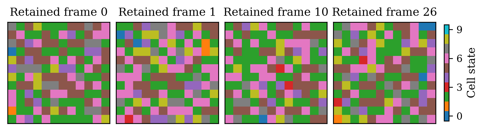
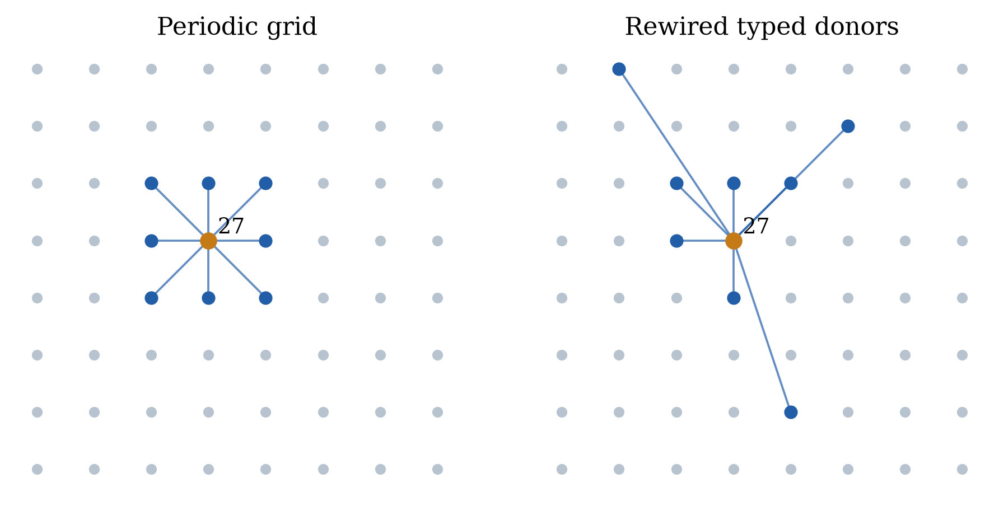
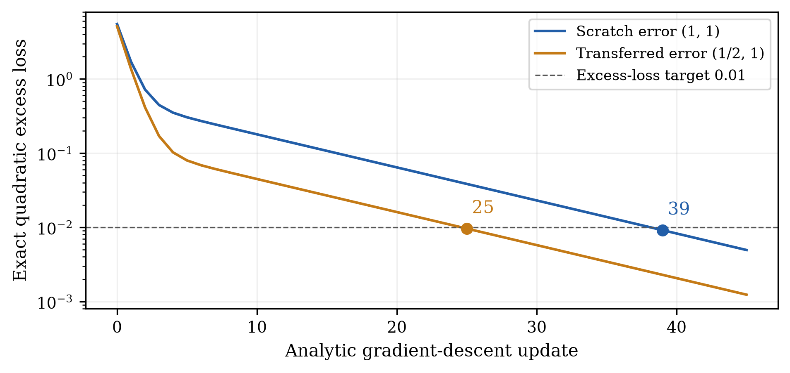
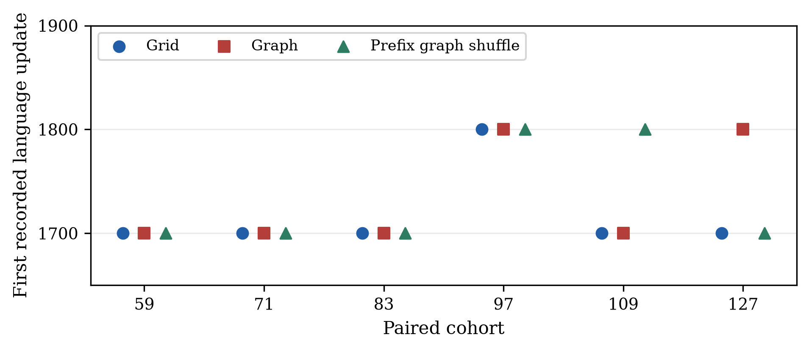
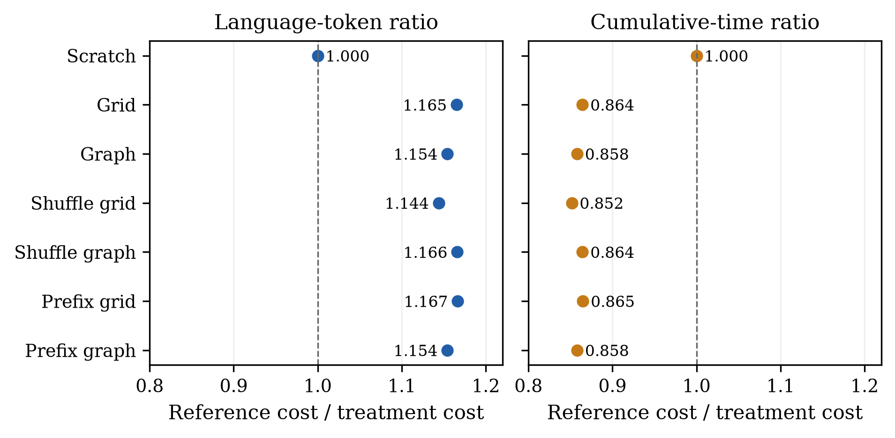
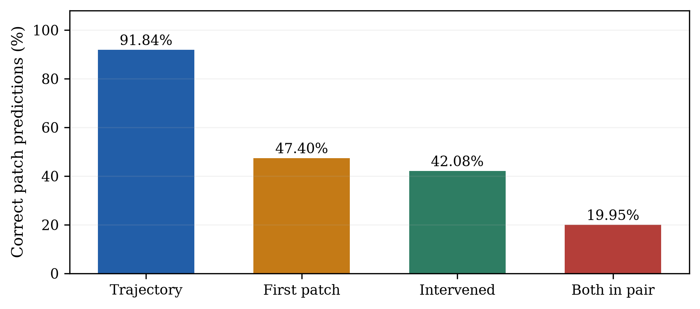
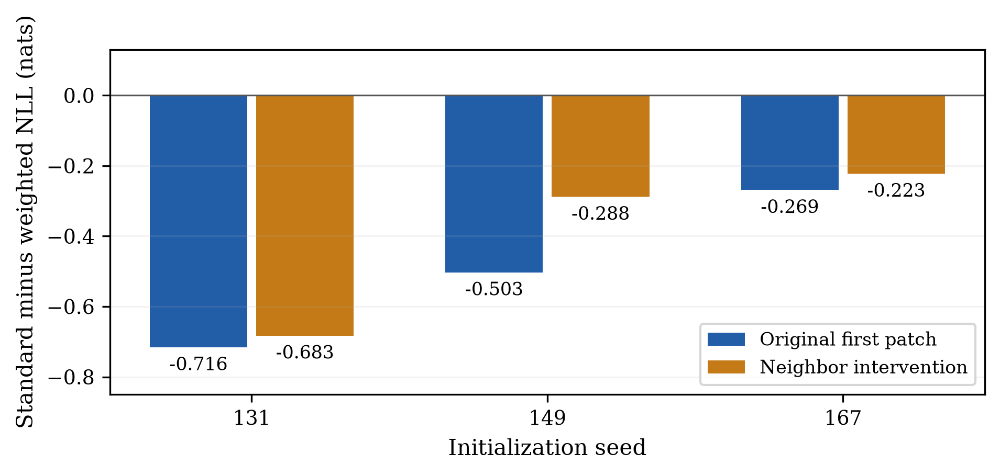
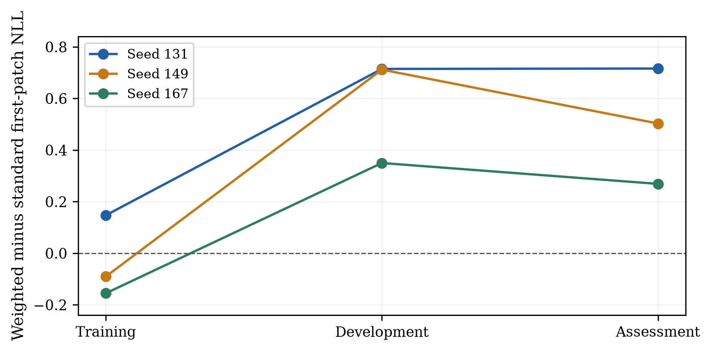

# Synthetic Pre-Pre-Training with Graph Neural Cellular Automata: Transfer, Control Failures and Spatial Generalization

Soumyajit Deb
Vellore Institute of Technology (VIT)
soumyajit.deb2026@vitstudent.ac.in
20 October 2026

## ABSTRACT

Objective: To determine whether synthetic pre-pre-training (PPT) with graph neural cellular automata improves subsequent language learning under an identical language stage, and whether any improvement depends on graph topology or temporal dynamics.

Contribution: We combine paired grid, graph and shuffled-data experiments with conditional transfer mathematics, selected Lean proofs, checkpoint audits and controlled spatial-rule diagnostics. The analysis separates language-stage transfer, synthetic predictive competence and cumulative cost.

Methods: Three versioned GPU development studies are retained separately. A seven-arm, six-cohort study supplies the strongest declared graph comparison. Subsequent CPU studies test causal frequency, known-rule trainability, neighbor intervention, loss weighting and existing-checkpoint fit across reused data splits.

Findings: Graph PPT in the six-cohort study uses about 13.4% fewer language tokens than scratch at the paired reference but about 16.6% more recorded cumulative time. Both co-primary graph-advantage tests fail. Stronger readiness rejects all 12 original structured cohorts. Controlled spatial models attain 91.84% trajectory accuracy but only 47.40% first-patch accuracy; sixfold first-transition weighting reduces the latter to 32.03%. A later inference-only diagnostic reveals training-to-assessment reversals in two seeds and training regression in the third, while teacher-forced whole-transition likelihood improves.

Applications: The resulting framework supports controlled studies of synthetic initialization and predictive evaluation. It does not establish production savings, reliable unseen-rule induction, graph-specific acceleration or reasoning gains.

Keywords: neural cellular automata; graph topology; synthetic pre-pre-training; language-model transfer; causal controls; spatial generalization; formal verification

## Nomenclature

**Symbols and measurement units**

| Symbol | Definition | Unit / scope |
| --- | --- | --- |
| n, q | Number of vertices; cell alphabet size | Counts |
| d, pi_r | Typed neighbor count; donor permutation of type r | Graph structure |
| x, omega | Cell configuration; frozen generator parameters | States / parameters |
| B, E | Transformer backbone; tied embedding/output table | Parameters |
| K, N | Synthetic updates; language updates | Updates |
| M, P, T | Tokens per frame; patches per frame; retained frames | Counts |
| L, ell | Mean predictive loss; one-target negative log-likelihood | Nats per target |
| eta, alpha | Synthetic step size; quadratic-model language step size | Model-specific |
| H, c_j | Quadratic Hessian; initial error in eigenmode j | Analytic surrogate |
| S_lang, S_cum | Reference cost divided by treatment cost | Dimensionless ratios |
| A_freq, A_order | Frequency and coherent-ordering advantages | Nats per patch |
| a, pi(v) | Frequency concentration; training-fitted prior | Positive scalar / probability |
| PPT, NCA, LM | Pre-pre-training; neural cellular automaton; language model | Abbreviations |
| NLL, CPU, GPU | Negative log-likelihood; central / graphics processor | Abbreviations |

All logarithms are natural unless bits are stated. NLL and accuracy use the explicitly named target mask. A speed ratio greater than one favors the treatment, while a ratio below one indicates greater measured cost. The historical byte-level pilot and categorical-token studies have different loss units and are not numerically pooled.

## 1. Introduction

Synthetic pre-pre-training asks whether a model can acquire a useful initialization before encountering natural language. The relevant treatment is a synthetic stage followed by a fully specified language stage. It is therefore necessary to distinguish a better starting backbone from extra language exposure, a shifted learning-rate schedule, or a larger total optimization budget. A comparison that changes several of these simultaneously does not isolate the intended transfer question.

Neural cellular automata provide locally generated, spatially structured sequences. Their transition rules can be shared across sites while the interaction topology, alphabet and initial condition remain controllable. In this work the graph neural network is a frozen random-rule data generator. The language learner is a separate causal transformer; no GNN layer is inserted into its language architecture. This separation permits topology to be treated as a property of the synthetic distribution rather than as a change in the downstream model.

A favorable comparison against scratch is only a first step. Shuffled synthetic sequences may transfer similarly because they retain frequency, formatting or other initialization-relevant statistics. Moreover, fewer language tokens need not repay synthetic optimization and preparation costs. The present study therefore asks four separate questions: whether synthetic initialization transfers; whether graph topology improves that transfer; whether coherent dynamics matter beyond matched frequency controls; and whether the measured savings exceed the added cost.

The research record is sequential and includes negative results. An initial matched-total-budget pilot had unequal language exposure and did not demonstrate a graph benefit. Later independent-stage studies corrected that estimand. Stronger controls then exposed weaknesses in the synthetic learning gate, motivating simpler controlled learning tasks rather than continued language training on inadequately understood synthetic checkpoints. The paper preserves that history instead of presenting only favorable endpoints.

The contributions are an audited set of paired development experiments; a mathematical account of graph, serialization and backbone-transfer assumptions; selected formally checked statements; and a progression of diagnostics showing why full-trajectory competence can overstate the first spatial prediction. A final decomposition explains how improved teacher-forced whole-transition likelihood can coexist with worse first-patch generalization. None of these contributions implies a guaranteed benefit from graph rewiring.

## 2. Related work and research gap

Lee et al. [1] motivate NCA-based synthetic-then-language training and report gains, including convergence acceleration up to 1.6x, in their larger experimental setting. Our work studies a much smaller model and an inspected WikiText-2 development task, with graph topology and stronger frequency controls as additional questions. Differences in architecture, corpus and budget prevent interpreting our numbers as a reproduction or a direct performance ranking.

Mordvintsev et al. [2] study neural cellular automata for learned pattern development. The present generator instead holds its sampled rule weights fixed while producing training sequences. The common principle is local shared computation, not an identical objective or representation. Gilmer et al. [3] provide a general message-passing formulation for graph learning. Here, typed donor relations preserve the positional roles of the local neighborhood, allowing a grid calculation and its graph generalization to share one rule.

The transformer architecture follows the causal sequence-prediction setting originating in attention-based models [4]. WikiText was introduced to support language modeling on longer natural contexts [5]. We use a small RoPE/RMSNorm/SwiGLU backbone and Adam-based optimization [6], without external pretrained weights. These implementation choices define the experiment; they do not establish that the synthetic data improve reasoning or transfer to another corpus.

The methodological gap is the separation of useful initialization from genuinely learned transition structure. A global frequency or copy baseline may be weak when a causal frequency predictor can exploit the observed initial frame. Likewise, a trajectory-average metric can be dominated by repeated frames, marker prediction or later teacher-forced patches. Our diagnostics address these distinctions through matched prefix shuffles, first-transition evaluation and a known neighbor-bit intervention.

Formal proof checking supplies a separate form of validation. Lean [7] checks precisely stated mathematical propositions under explicit assumptions; it cannot certify that an empirical treatment helps a language model. We therefore report the proof boundary alongside, rather than in place of, dataset integrity, checkpoint replay and statistical analysis. Detailed local protocols and evidence accompany this paper in the research bundle [8].

## 3. Mathematical formulation

### 3.1. Typed graph dynamics and categorical rules

Let the vertex set have n elements. Each relation type r is represented by a donor permutation pi_r and its permutation matrix P_r. A periodic Moore grid has eight non-self relation types, with the central state supplied separately. Rewiring exchanges donors within a type while retaining one incoming and one outgoing relation of that type at every vertex. Additional checks exclude extra self edges and duplicate donors.

$$
u_i=[\mathrm{onehot}_q(x_i);\mathrm{onehot}_q(x_{\pi_1(i)});\ldots;\mathrm{onehot}_q(x_{\pi_d(i)})]
$$

$$
\ell_i=W_3\,\mathrm{ReLU}(W_2W_1u_i),\qquad x_i^+=\arg\max_a(\ell_{i,a}+\tau g_{i,a})
$$

For the categorical generator, the perception, hidden and output maps are sampled once per rule and remain frozen. Independent Gumbel draws g define the finite-temperature transition. At zero temperature the update is deterministic, with a consistent tie convention. The measured categorical configuration uses temperature 0.0001, so deterministic entropy results below are conditional models rather than literal bounds on that stochastic generator.

On a periodic grid, the first affine perception map is exactly a 3 x 3 spatial cross-correlation after matching channel and neighbor order. The subsequent maps are pointwise. This equivalence follows by expanding the same weighted sum over offsets. It does not make graph rewiring an optimization of the grid calculation: changing donor indices changes the synthetic process itself.

$$
F_{\omega,\Pi G}(\Pi x)=\Pi F_{\omega,G}(x)
$$

To prove relabeling equivariance, replace every P_r by Pi P_r Pi inverse. The gathered states are relabeled consistently, and the same local map acts at each site. This graph statement does not imply invariance of a raster-serialized transformer with positional information.

### 3.2. Degree preservation, mixing and operator perturbations

A within-type donor swap composes one permutation with a transposition and hence preserves its bijectivity. Degree preservation alone does not preserve connectivity, eigenvalues or useful predictive structure. For example, divide 64 vertices into two groups of 32 and use the eight nonzero cyclic offsets -4,-3,-2,-1,1,2,3,4 independently inside each group. All typed degrees remain valid, with no self or duplicate neighbors, but the resulting graph is disconnected.

$$
Q_G=\frac{I+\sum_{r=1}^{8}P_r}{9},\qquad \rho_{8\times8}=\frac{1+\sqrt{2}}{3}=0.8047378541
$$

This doubly stochastic linear surrogate preserves the mean. On the symmetric 8 x 8 periodic grid, Fourier modes yield the displayed largest nonconstant magnitude. The norm contraction bound requires 11 steps for a factor 0.1 and 22 for a factor 0.01. These are exact surrogate calculations, not observed relaxation times for the nonlinear categorical NCA. Directed graph behavior requires singular-norm or other justified control; eigenvalue intuition alone is insufficient.

$$
\|\mathcal{G}_G-\mathcal{G}_{\mathrm{grid}}\|_F^2=2h
$$

Here the gather operators stack relation inputs and h counts changed donor slots, each replacing one unit entry by another. Every changed row contributes two to the squared Frobenius norm. The identity measures input-operator change; it does not determine the downstream logit margin or transfer direction.

### 3.3. Information, serialization and causal visibility

$$
H(X^{0:T}\mid\omega,G)\leq H(X^0\mid\omega,G)\leq n\log q
$$

Under a deterministic transition and known rule, the entire trajectory is a function of its initial configuration. Its conditional entropy cannot exceed that of the initial state. Unknown rules add rule uncertainty; stochastic transitions add new randomness. A gzip complexity ratio is a screening statistic and is not an exact Shannon entropy estimator or a proof of useful complexity.

$$
z=a+qb+q^2c+q^3d,\qquad 0\leq z<q^4
$$

Four cell values form one 2 x 2 patch token. Repeated base-q division recovers the four digits, proving the encoding is bijective. Markers delimit frames. For a 12 x 12 grid there are 36 patches and 38 tokens per frame; 27 retained frames produce 1026 tokens, while training uses the declared 1025-token prefix to form 1024 inputs and targets.

$$
\mathrm{lag}_r(i)=M+s(i)-s(\pi_r(i)),\qquad \frac{1}{n}\sum_i\mathrm{lag}_r(i)=M
$$

Because pi_r permutes the vertices, the two sums of serialization ranks cancel. Rewiring can change lag dispersion and which parents fit into a cropped prefix even when the mean is unchanged. The maximum one-step patch lag is 73 for the 12 x 12 categorical layout; visibility is a geometric property, not evidence that a transformer learns the rule.

Four decoded 12 x 12 state frames from held-out rule row 0 in the preserved v2 validation array. Frame numbers index retained frames after burn-in. Colors denote categorical states, not probabilities. This is a saved data example, not a new rollout or a representative sample of all rules.

Historical binary CPU topology example: only the eight non-self donors of receiver 27 are drawn on fixed vertex labels, for grid and rewired relations. There are 113 changed typed donor slots among 512 in the full retained topology. These data are not the v3/v4 categorical topology or a measured transfer effect.

### 3.4. Backbone reset and a sufficient transfer condition

Write the synthetic parameters as a backbone B and tied token table E. Language transfer keeps the trained backbone and replaces the synthetic table with the same fresh language table E0 in every paired arm. The fresh optimizer and schedule also restart at language update zero. Learning the synthetic output vocabulary alone therefore cannot constitute the transferred endpoint.

$$
\mathcal{T}(B,E)=(B,E_0),\qquad D\mathcal{T}(\delta B,\delta E)=(\delta B,0)
$$

Let f(B) be the language loss with E0 held fixed immediately after transfer. Assume its gradient is L-Lipschitz on the segment from the common initial backbone B0 to B0+delta. Taylor integration then bounds the remainder without requiring global convexity.

$$
f(B_0+\delta)-f(B_0)-g^\top\delta=\int_0^1[\nabla f(B_0+t\delta)-g]^\top\delta\,dt
$$

Cauchy-Schwarz and gradient Lipschitzness bound the absolute integrand by L times t times the squared displacement norm. Integrating t from zero to one gives the one-half coefficient in the remainder bound below. Thus the displayed condition is sufficient under local smoothness rather than an unconditional property of synthetic data.

$$
|f(B_0+\delta)-f(B_0)-g^\top\delta|\leq\frac{L}{2}\|\delta\|^2,\qquad g=\nabla f(B_0)
$$

$$
-g^\top\delta>\frac{L}{2}\|\delta\|^2\quad\Longrightarrow\quad f(B_0+\delta)<f(B_0)
$$

The implication follows by using the upper Taylor bound. For a single synthetic gradient step delta = -eta g_syn, favorable gradient alignment must dominate the quadratic remainder. For Adam, clipping, momentum and decay, the actual update direction replaces a plain gradient. For a full synthetic stage, the total observed backbone displacement is the relevant delta. None of these inequalities proves that graph rewiring supplies a favorable displacement.

$$
g^\top g_{\mathrm{syn}}>\frac{L\eta}{2}\|g_{\mathrm{syn}}\|^2
$$

### 3.5. Exact convergence and the two cost clocks

$$
f_n-f_* =\frac{1}{2}\sum_j\lambda_j(1-\alpha\lambda_j)^{2n}c_j^2
$$

For an exactly quadratic positive-definite objective and full-batch gradient descent with 0 < alpha < 2 / largest eigenvalue, diagonalization gives this expression. Initial error in slowly contracting modes can dominate late convergence. A lower initial loss alone need not improve later loss; a two-mode ranking reversal is supplied in the mathematical research note.

A worked example uses Hessian diag(1,10), step size 0.05, scratch error (1,1), and transferred error (1/2,1). Only the slow-mode coefficient changes. The following expressions and neighboring evaluations establish exact first hits without simulating an optimizer.

$$
f_0(n)-f_*=\frac{1}{2}(0.95^{2n}+10\,0.5^{2n})
$$

$$
f_G(n)-f_*=\frac{1}{2}(0.25\,0.95^{2n}+10\,0.5^{2n})
$$

**Exact first hits in the constructed quadratic model**

| Initialization | Previous update / loss | First hit / loss |
| --- | --- | --- |
| Scratch | 38 / 0.01013827358 | 39 / 0.00914979190 |
| Transferred | 24 / 0.01065719879 | 25 / 0.00961812191 |

Both component powers decrease strictly, so the neighboring inequalities establish first hits at 39 and 25 for target excess loss 0.01. Their ratio is 1.56. This is a mathematical toy value and is never substituted for an empirical language speedup.

$$
S_{\mathrm{lang}}=\frac{c_0N_0}{c_GN_G},\qquad S_{\mathrm{cum}}=\frac{c_0N_0}{C_{\mathrm{gen}}+c_{\mathrm{ppt}}K+c_GN_G}
$$

$$
c_0N_0-c_GN_G>C_{\mathrm{gen}}+c_{\mathrm{ppt}}K
$$

Strict cumulative benefit holds exactly when language-stage cost savings exceed the charged preparation and synthetic optimization costs. These are analytic cost variables. Empirical cumulative ratios below use their documented recorded accounting scope, not an invented exhaustive lifecycle bill. In the equal-step, zero-generation toy example, K=10 gives 39/35=1.114286, while K=20 gives 39/45=0.866667 despite identical language gain.

Closed-form quadratic excess losses, with the 0.01 target and first hitting updates 25 and 39. No NCA training, language measurement or fitted convergence rate supplies this figure.

## 4. Numerical methodology and implementation

### 4.1. Versioned experiments and fixed language stages

**Study identities and independent observational units**

| Study | Arms / paired replicates | Endpoint and qualification |
| --- | --- | --- |
| Pilot 1 | Five / three model seeds | 1000 text versus 100 synthetic + 900 text; scheduler confound |
| V2 GPU | Three / three model seeds | 1000 PPT then identical 2000 language updates; one shared synthetic cache |
| V3 GPU | Five / three paired cohorts | Independent synthetic caches/topologies; grid-endpoint primary can be censored |
| V4 GPU | Seven / six fresh paired cohorts | Common scratch-endpoint co-primary graph comparisons |
| Stages 5 and 9 | Existing checkpoints only | CPU scoring, no new optimizer updates |
| Stages 6, 7 and 8 | 6, 12 and 6 new CPU models | Fixed 1000-update controlled-rule development studies |

Pilot 1 is retained as a historical negative result and is not relabeled as the independent-stage study. It charged a matched total token budget but gave scratch and synthetic treatments different text exposures and scheduler positions. V2-v4 instead start every language stage from update zero with the same 2000 language updates, architecture, fresh token table, optimizer procedure, minibatch/window order and validation within a replicate. Scratch receives no compensating extra language or synthetic stage.

The categorical studies use six transformer blocks, width 192, four attention heads and context 1024. The transferable backbone contains 2,656,704 parameters. With tied tables, the 10002-token synthetic model has 4,577,088 parameters and the 50257-token language model has 12,306,048. The actual code uses causal attention, RoPE, RMSNorm and SwiGLU. The smaller controlled binary model later keeps that full backbone but has vocabulary 18 and total size 2,660,160.

**Shared categorical GPU configuration and exposure**

| Item | Frozen value / accounting |
| --- | --- |
| Generator | 12 x 12 cells; q=10; burn-in 10; temperature 0.0001 |
| Synthetic population | 4096 training rules and 128 held-out rules per cache; evaluation uses first 32 |
| Synthetic budget | 1000 updates; 4.096 million input-token exposures per arm |
| Language budget | 2000 updates; 8.192 million input-token exposures per arm |
| Effective batch | Batch 2 with two accumulation steps; 4096 input tokens per update |
| Optimizer | Adam; PPT LR 0.0001; language LR 0.0005; 10% warmup then cosine |
| Language data | WikiText-2 raw, GPT-2 tokenizer; official test unused in v2-v4 |
| Evaluation | 100-update cadence; fixed 32768-token development evaluation |
| Execution | User-run Kaggle Tesla T4, deterministic FP32 configuration |

Token counts are optimization exposures, including repeated sampled corpus windows, and are not counts of unique text. Finite-temperature rules are frozen, rule-disjoint caches retain their original identities, and graph/grid use common rollout random draws. V3/v4 jointly filter grid and graph profiles; that retained population differs from v2 and must not be silently pooled with it. Gzip filtering does not supply a general learning guarantee.

### 4.2. Controls, crossings and conservative inference

V4 retains scratch, grid, graph, original shuffled grid, original shuffled graph, prefix-matched shuffled grid and prefix-matched shuffled graph. The stronger control preserves the full initial conditioning frame, marker values and positions, and the histogram of supervised-prefix patch tokens. It shuffles the unused suffix separately, so no token crosses into or out of the trained prefix. The earlier shuffle controls remain available rather than being replaced after inspection.

$$
N_a(\ell_*)=\min\{k\in\mathcal{E}:L_a(k)\leq\ell_*\}
$$

The evaluation set E is the recorded 100-update grid. No interpolation is used. If the set is empty within the horizon, the crossing is censored. V3 uses each paired grid endpoint as its primary reference. V4 fixes the same per-cohort scratch endpoint for both graph comparisons. These different targets remain distinct.

$$
S=\exp\!\left(\frac{1}{m}\sum_{s=1}^{m}\log\frac{N_{\mathrm{ref},s}}{N_{a,s}}\right)
$$

Geometric averaging preserves multiplicative cost comparisons. An all-cohort primary ratio is withheld if a required crossing is missing; it is not recomputed on successful seeds only. V4 uses six paired cohorts and a declared one-sided binomial sign calculation that counts ties as non-wins, rather than discarding ties. With w strict graph wins, the null tail is the probability that Binomial(6,1/2) is at least w. Each of two co-primary tests uses alpha 0.025, and both must pass. This deliberately conservative rule is not an equivalence test.

### 4.3. Causal frequency and readiness

$$
p(z_{1:m}\mid n_0)=\frac{\Gamma(A)}{\Gamma(A+m)}\prod_v\frac{\Gamma(\beta_v+m_v)}{\Gamma(\beta_v)},\quad \beta_v=a\pi(v)+n_{0v}
$$

Here A is the sum of beta, n0 counts initial-frame patches, and m_v counts the subsequent scored patch tokens. This expression is the probability of the ordered sequence under a sequential exchangeable predictor, not a multinomial count probability; no combinatorial count factor is inserted. Each predictive factor uses past counts only. The concentration and prior are fitted on training data. The closed form can use final counts to evaluate that same causal product without giving future counts to individual predictions.

The probability depends only on the preserved initial and target histograms, so the prefix-matched shuffle has identical total frequency likelihood. This makes the predictor a useful falsification control for a claim that the transformer has learned additional sequential structure. The post-hoc frequency audit preceded the readiness study and is not presented as an independently rediscovered outcome.

$$
A_{\mathrm{freq}}=L_{\mathrm{freq}}-L_\theta(\mathrm{coherent}),\quad A_{\mathrm{order}}=L_\theta(\mathrm{shuffle})-L_\theta(\mathrm{coherent})
$$

Both model terms in the ordering advantage use the same checkpoint. Stage 5 requires both advantages to reach 0.01 nats per patch in every structured cohort before its language-start guard accepts the checkpoint. Comparisons with separately shuffle-trained models are descriptive controls. Readiness is a predictive requirement, not a causal theorem linking synthetic competence to language transfer.

### 4.4. Controlled spatial learning and intervention

Stage 6 deliberately simplifies the task to a binary complement rule on a 4 x 4 periodic lattice with eight frames, vocabulary 18 and context 47. Three coherent/prefix-shuffled model pairs receive 1000 updates and 188000 input-token exposures each. Training, development and assessment contain 512, 64 and 128 initial conditions, with complement phases excluded across splits. This jointly changes several task factors and cannot identify which factor caused the original random-rule failure.

Stage 7 introduces spatial interaction while training a new matched complement reference. Both rules use the same new joint-orbit-disjoint split, actual full starting weights, batch orders, architecture, optimizer and budgets. Historical stage 6 is not used as that controlled reference. Each of three seeds trains four arms, giving twelve new CPU models. Full-trajectory assessment uses 28 patch targets per held-out trajectory.

$$
F_c(x)=1+x,\qquad F_s(x)=1+x+S_Lx+S_Rx\quad\mathrm{over}\ \mathbb{F}_2
$$

Both rules have period two. For the spatial rule let A=I+S_L+S_R. On a periodic row of length four, S_L S_R=I and S_L squared equals S_R squared. In characteristic two, cross terms cancel, so A squared=I and A applied to the all-ones vector is the all-ones vector. Therefore F_s(F_s(x))=x. Exhaustive source tests cover all 65536 initial configurations. This displayed algebra is not an additional Lean theorem.

$$
A^2=I+S_L^2+S_R^2=I,\qquad F_s(F_s(x))=1+A1+A^2x=x
$$

Repeated-frame recall could improve later predictions without solving the first spatial transition. A supplementary protocol, frozen during stage 7 training before assessment, therefore scores the first patch after the initial complete frame and next start marker. Flipping initial cell (0,3), outside the target patch but adjacent across the periodic boundary, must flip bit zero of the spatial target and leave the complement target unchanged. All 128 original queries remain; a fixed phase-exclusion mask leaves 122 eligible changed pairs. No repeated or new-frame patch is available for the first query.

### 4.5. Fixed-budget weighting and checkpoint-only generalization

Stage 8 changes only the supervised objective. The six first-transition targets receive weight six and the 36 later valid targets weight one; initial-context targets remain masked. New weighted coherent/prefix-shuffled models start from the same initial states and batch orders as the six verified stage 7 spatial standard-loss controls. Those controls are imported historical CPU runs, not newly retrained endpoints. Each new model still receives 1000 updates, 188000 input tokens and 168000 valid target exposures.

$$
L_w=\frac{6\sum_{j\in T_1}\ell_j+\sum_{j\notin T_1}\ell_j}{72},\qquad |T_1|=6
$$

The first transition contributes half the normalized loss instead of one seventh. Its four patches and two markers retain the aggregate two-thirds patch/one-third marker ratio. The first patch alone receives one twelfth of total objective weight; the treatment is not an isolated first-patch loss. Assessment always uses the original unweighted likelihood. Every coherent seed must improve both original and intervened first-patch NLL by at least 0.01 while retaining trajectory readiness. The final update is fixed and all three seeds must pass.

Stage 9 was declared after inspecting stage 8, then frozen before computing new train/development split scores. It performs no fitting. Fifteen existing initial/standard/weighted model conditions are scored on both coherent and actual prefix-shuffled data in each of three splits, giving 90 cells. The original short-prefix first-patch scorer remains authoritative. A separate causal pass evaluates all four first-transition patches and both markers; later patches condition on preceding true patches. This is teacher forcing, not rollout accuracy.

## 5. Mathematical validation, verification and provenance

The mathematical note contains seven sections of derivations, explicit assumptions, numerical substitutions and counterexamples. A selected 44-statement Lean core was checked in the official Lean 4.35.0 web editor. Retained source hashes and axiom reports bind that evidence to the statements. The earlier failed check is preserved, and no unproved placeholder is accepted as a completed theorem.

**Scope of formal and numerical validation**

| Claim family | Retained coverage | Boundary |
| --- | --- | --- |
| Graph and serialization | Equivariance, typed swap, lag sums, binary patch encoding and visibility | No learned transformer invariance, mixing improvement or full categorical encoding proof |
| Backbone transfer | Product reset identities and conditional Taylor/cost algebra | Reset derivative and calculus deriving the Taylor remainder remain informal |
| Analytic convergence | Scalar/diagonal recurrences, coefficient comparison, ranking reversal, first hits | No full transformer Hessian or empirical acceleration theorem |
| Other mathematical arguments | Written entropy, spectra, perturbation and surrogate derivations | Not formalized in the selected Lean core |
| Empirical consistency | Independent CPU checkpoint replay of imported GPU states; retained hashes | Replays are not new GPU timings or proof of efficacy |

Allowed dependencies in the retained Lean reports are subsets of the standard foundational axioms propext, Classical.choice and Quot.sound, or no axioms. The Taylor bound is a hypothesis of the checked transfer algebra. The product reset identities are formalized, but the differential shown in Section 3 remains a written derivation. Spectral theory, entropy and the complete matrix/Hessian analysis are not claimed mechanically checked. No new Lean execution is implied by packaging their sources with this paper.

Independent CPU checks cover 15 selected v2 development checkpoints, 27 selected v3 states and three v3 initializations, and 78 selected v4 states with six actual starting states. Maximum metric discrepancies are 1.9563e-7, 1.8552e-7 and 2.7828e-7 NLL, respectively. Saved intermediate curves are audited as logs where no intermediate weights exist. Cross-runtime bitwise regeneration of some historical initialization or schedule bytes has limits; actual within-run paired controls and retained saved states are checked separately.

Controlled stages preserve frozen plans, input/source hashes, checkpoints, per-query scores and independent reload invocations. Stage 8 reproduces all 30 full-trajectory and 15 first-transition cases exactly. Stage 9 reproduces all 90 cells and all 15 stage 8 assessment vectors; its short/long-prefix loss discrepancy is at most 4.7684e-7 nats with identical first-patch correctness. These replays use the same frozen scorers and are not independently implemented losses or retraining.

## 6. GPU results: transfer without established graph advantage

### 6.1. Historical pilot and v2 development evidence

The historical fixed-total-budget pilot was unfavorable to graph NCA: its paired geometric time to the declared 2.5-nats/byte target was 1.432 times that of target-text-only training, with final held-out NLL worse by 0.053230 nats/byte. Its unequal language exposure and scheduler confound limit interpretation. These results are not merged with the categorical studies; its original test use also does not imply official-test use in v2-v4.

V2 provides a modest independent-stage transfer signal. At each paired scratch endpoint, grid reaches the target after 1800, 1600 and 1700 updates, and shuffled NCA after 1700, 1600 and 1800, against scratch at 2000. Both have geometric language-token speedup 1.177831. Mean final NLL is 5.266091 for scratch, 5.233321 for grid and 5.231528 for shuffle. Grid cumulative-time speedup is 0.886170, corresponding to about 12.8% more recorded cumulative time. V2 contains no graph treatment.

Similar shuffled gains leave the structured-dynamics contribution unresolved. V2 shares one synthetic cache across its three model seeds and evaluates an inspected small language prefix. This is not a general acceleration estimate, a reasoning benchmark result or untouched-domain confirmation.

### 6.2. V3 graph versus grid and censored primary crossings

**V3 primary paired graph/grid comparison**

| Seed | Grid final NLL | Graph final NLL | First graph crossing of grid endpoint |
| --- | --- | --- | --- |
| 17 | 5.229810 | 5.213048 | 1800 |
| 29 | 5.244098 | 5.242078 | 2000 |
| 43 | 5.239526 | 5.241660 | Not reached by 2000 |

The mean graph-minus-grid endpoint difference is -0.005550 nats/token, largely driven by seed 17. One primary crossing is censored, so an all-seed primary speedup is withheld. Graph versus shuffled graph is also mixed. A secondary scratch-reference comparison gives graph language-token speedup 1.178 and cumulative-time speedup 0.872; those favorable scratch numbers do not replace the declared grid-endpoint analysis.

### 6.3. V4 stronger controls and the frozen co-primary tests

**V4 final language quality and paired scratch-reference costs**

| Initialization | Final NLL | Language-token ratio | Cumulative-time ratio |
| --- | --- | --- | --- |
| Scratch | 5.273956 | 1.000000x | 1.000000x |
| Grid | 5.230608 | 1.165316x | 0.864328x |
| Graph | 5.234337 | 1.154268x | 0.857989x |
| Original grid shuffle | 5.236298 | 1.143913x | 0.851626x |
| Original graph shuffle | 5.234172 | 1.165990x | 0.864376x |
| Prefix grid shuffle | 5.235063 | 1.166591x | 0.864891x |
| Prefix graph shuffle | 5.235680 | 1.154268x | 0.858035x |

All seven arms complete six fresh paired cohorts. Graph uses about 13.4% fewer language tokens than scratch at the paired reference, but about 16.6% more recorded cumulative time. Final graph NLL is about 0.003729 nats/token worse than grid, with graph worse in five of six endpoint pairs. Original and stronger prefix-matched shuffles retain similar transfer. The extra synthetic stage is not repaid at this measured horizon.

**Frozen V4 primary comparisons at the same scratch target**

| Graph versus | Wins / ties / losses | Geometric token ratio | One-sided p |
| --- | --- | --- | --- |
| Grid | 0 / 5 / 1 | 0.990519x | 1.000000 |
| Prefix graph shuffle | 1 / 4 / 1 | 1.000000x | 0.984375 |

Neither co-primary test reaches its fixed 0.025 requirement. There are no censored crossings in these two comparisons. Most paired crossing counts tie on the 100-update evaluation grid. The result fails to demonstrate graph-specific acceleration; it does not establish equivalence or exclude smaller differences below that resolution. No alternative target, successful-seed subset or revised significance rule replaces the frozen analysis.

First recorded language updates at each cohort's scratch endpoint. Grid, graph and prefix-matched graph shuffle use the same target within each cohort. Discrete ties and the unfavorable graph crossing in seed 127 remain visible; no interpolation supplies extra wins.

Geometric ratios versus each paired scratch endpoint, recalculated from the reviewed aggregate record. The two denominators differ. Ratios above one favor the treatment. Recorded cumulative accounting does not supply a complete deployment lifecycle cost estimate.

## 7. CPU diagnostics: predictive competence and first spatial errors

### 7.1. Stronger readiness fails for the original random-rule checkpoints

**Stage 5 checkpoint readiness, means over six cohorts**

| Advantage, nats per patch | Grid | Graph |
| --- | --- | --- |
| Frequency baseline minus coherent model | -0.587546 | -0.297951 |
| Same checkpoint: shuffle minus coherent | 0.000849 | 0.000987 |
| Ordering gap beyond prefix-trained control | 0.000092 | 0.000102 |

All 12 structured cohorts fail both 0.01-nat requirements. The largest individual ordering advantage is 0.004817, below the threshold, and the actual language-start guard rejects the checkpoints. A learned known-rule transition-table measurement control passes, while a frequency-only negative fails. That validates measurement behavior, not transformer learning of the original random rules. The 48-cell study scores 24 existing checkpoints and performs no neural training.

### 7.2. Complement trainability succeeds on a simpler fixed rule

All three coherent stage 6 models pass both readiness requirements. Their mean held-out patch NLL is 0.056417 and patch accuracy 100%, against causal frequency NLL 2.305334. The six CPU models complete 6000 updates and 1.128 million input-token exposures. Recorded stage timers total 6.966 minutes. These timings are not GPU speedups. The task is a non-interacting known complement rule, so success does not establish unseen-rule induction or graph competence.

Shuffle-trained stage 6 models also pass the absolute numerical margins, with much smaller ordering gaps and about 27% coherent accuracy. This is an important limit of the readiness criterion: admission alone does not identify the training mechanism. It also motivates reporting accuracy and same-checkpoint coherent/shuffled scores rather than a pass/fail label alone.

### 7.3. Matched spatial learning succeeds unevenly across prediction positions

**Stage 7 matched full-trajectory assessment**

| Rule | Patch NLL | Patch accuracy | Frequency NLL | Own-patch table NLL |
| --- | --- | --- | --- | --- |
| complement | 0.055023 | 100.00% | 2.352583 | 0.016619 |
| spatial | 0.303136 | 91.84% | 2.106976 | 2.814026 |

All three coherent spatial models pass readiness and beat the train-only previous-own-patch table by the declared margin. The table lacks neighboring-patch inputs and is not a Bayes-optimal bound over all possible local predictors. The spatial models attain 91.84% full-trajectory patch accuracy, but first-patch accuracy is only 47.40% on original queries and 42.08% after the neighbor intervention. Both predictions are correct in only 19.95% of eligible pairs. The complement reference reaches 100% original and changed-query accuracy.

The first-transition NLL comparison passes for all coherent spatial seeds, but its likelihood margin does not imply reliable rule execution. Spatial shuffle-trained controls pass that small supplementary NLL margin too, with much weaker accuracy. These findings support partial known-rule learning and the usefulness of the intervention; they do not identify a unique internal circuit or generalization to arbitrary rules.

Means across three stage 7 coherent spatial models: trajectory patch accuracy, original first-patch accuracy, intervened first-patch accuracy and paired-both correctness. Target populations differ: 128 x 28 trajectory patches, 128 original queries, and 122 eligible intervention pairs per seed. These bars are not equivalent independent samples.

### 7.4. First-transition weighting is negative under its frozen primary

**Stage 8 fixed-budget coherent-model outcome**

| Metric | Standard objective | Sixfold transition weight |
| --- | --- | --- |
| Original first-patch NLL | 1.461689 | 1.957809 |
| Original first-patch accuracy | 47.40% | 32.03% |
| Intervened first-patch NLL | 1.608771 | 2.006729 |
| Intervened first-patch accuracy | 42.08% | 30.05% |
| Both predictions correct | 19.95% | 11.20% |
| Full-trajectory patch NLL | 0.303136 | 1.347235 |
| Full-trajectory patch accuracy | 91.84% | 50.86% |

Every coherent seed worsens both original and intervened first-patch NLL. Standard-minus-weighted original improvements are -0.716168, -0.503166 and -0.269025; intervention improvements are -0.682965, -0.288322 and -0.222588. The primary therefore fails in all three seeds even though inherited full-trajectory readiness still passes. Full-trajectory accuracy also declines, from 91.84% to 50.86%. No seed, factor, budget or endpoint is changed after inspection.

All six new weighted models complete their matched 1000-update budgets. Their stage timers sum to 7.481 CPU minutes; the six imported controls account for 6.729 historical CPU minutes. These are not simultaneously measured throughput controls or evidence of GPU efficiency. Coherent-minus-shuffled weighting gains are negative in every seed and remain descriptive. The failed primary does not by itself identify why weighting hurt the first spatial query.

Per-seed standard-minus-weighted NLL on original and intervened stage 8 first-patch queries. Positive values would favor weighting, but every displayed value is negative. These are paired fixed-endpoint CPU outcomes, not a convergence-rate estimate.

## 8. Checkpoint-only fit and a decomposition of aggregate prediction

### 8.1. Stage 9 separates training fit from held-out behavior

**Stage 9 principal first-patch deltas: weighted minus standard**

| Seed | Train | Development | Assessment | Descriptive category |
| --- | --- | --- | --- | --- |
| 131 | 0.147160 | 0.714747 | 0.716168 | Train and held-out regression |
| 149 | -0.090349 | 0.711946 | 0.503166 | Training gain, held-out reversal |
| 167 | -0.155300 | 0.349933 | 0.269025 | Training gain, held-out reversal |

Seeds 149 and 167 improve training first-patch likelihood but worsen both held-out splits. Seed 131 worsens on training data too. The categories use a 0.01-nat descriptive margin frozen before the new split scores. A pooled training mean would conceal this distinction. The result describes fixed endpoints; it is not a causal attribution to capacity, gradient interference or a particular shortcut.

**Stage 9 coherent-model split means**

| Split / objective | First-patch NLL | First accuracy | Four-patch NLL | Four accuracy |
| --- | --- | --- | --- | --- |
| train / standard | 0.843632 | 75.39% | 0.799360 | 78.42% |
| train / weighted | 0.810802 | 83.46% | 0.684029 | 87.48% |
| development / standard | 1.315831 | 54.17% | 1.672529 | 40.10% |
| development / weighted | 1.908040 | 39.06% | 1.652497 | 42.97% |
| assessment / standard | 1.461689 | 47.40% | 1.629741 | 42.90% |
| assessment / weighted | 1.957809 | 32.03% | 1.549562 | 46.48% |

The 90 scoring cells comprise repeated measurements of 704 cached initial conditions and three initialization seeds, not 21120 independent rule/data cohorts. All initial models and shuffled controls remain in the source results. Coherent assessment first-patch vectors reproduce stage 8 exactly. The new scores use no optimizer update, additional intervention, changed checkpoint or official language-test access. They are post-hoc development evidence on reused splits, not confirmation.

Weighted-minus-standard first-patch NLL by seed and reused split. Positive values mean weighting is worse. Two seeds improve training fit but reverse on held-out data; the third regresses in both. No error bar, p-value or independent-cohort interpretation is assigned to the repeated query rows.

### 8.2. Why whole-transition improvement can hide a first-patch failure

Let L1 denote first-patch NLL and L1:4 the mean of the four first-transition patch losses, with fixed equal target counts. Later patches in L1:4 condition on earlier true patches. Subtracting the standard endpoint from the weighted endpoint gives an exact decomposition, not a new model evaluation.

$$
\Delta L_{1:4}=\frac{\Delta L_1+\Delta L_2+\Delta L_3+\Delta L_4}{4}
$$

$$
\Delta\overline{L}_{2:4}=\frac{4\Delta L_{1:4}-\Delta L_1}{3}
$$

Using the full-precision stage 9 coherent assessment means, the first-patch delta is 0.496120 nats and the four-patch delta is -0.080179 nats. The implied mean change over patches two through four is -0.272279 nats. Thus later teacher-forced patch likelihood improves enough to offset the first-patch deterioration in the aggregate. This arithmetic does not claim autonomous rollout improvement or a learned causal mechanism.

$$
L_{\mathrm{six}}=\frac{4L_{1:4}+2L_{\mathrm{markers}}}{6}
$$

The six-token transition score also includes two markers, whose NLL is much smaller than patch NLL. Separating marker and patch terms prevents easy formatting predictions from being mistaken for spatial competence. The observed weighted four-patch NLL is lower on train and assessment in every coherent seed, while the authoritative assessment first-patch NLL is worse in every seed. This qualifies the stage 8 interpretation without reversing its frozen failure.

## 9. Discussion, applications and limitations

### 9.1. What the comparisons establish

Across the independent-stage GPU development studies, synthetic initialization helps relative to scratch under the specified language stage. Similar shuffled gains, a partly censored v3 primary result and failed v4 co-primary tests prevent attributing that benefit to graph topology or coherent NCA dynamics. The stronger frequency predictor explains why beating a global unigram/copy gate is inadequate evidence of learned local transition structure.

The controlled CPU progression is more specific. A full backbone can learn a simple complement mapping, so a universal inability of the architecture to learn any synthetic rule is unsupported. Adding spatial interaction produces partial first-transition competence under matched conditions. Weighting an aggregate transition objective changes different prediction positions differently; the observed first-patch failure survives even when teacher-forced aggregate likelihood improves. The mathematics shows how those statements can coexist.

### 9.2. Potential applications and larger-scale requirements

A verified reusable synthetic initialization could be useful when downstream training data or compute are constrained. The current results support an experimental framework for investigating that possibility, not a deployment recommendation. Different language, code and mathematical domains require separate confirmation and task-level benchmarks; lower development NLL alone does not establish reasoning, robustness or reliability.

Larger-scale work should declare its target and full cost scope, freeze a competent synthetic configuration before language training, retain grid and matched shuffled controls, and use fresh paired cohorts. A shared initialization may amortize preparation across several downstream uses, but the number of uses and storage/validation costs must be stated. Reusing a cache changes accounting; it does not erase its original cost.

The next candidate suggested by stage 9 is initial-condition diversity alone, with objective definitions, rule, representation, backbone and update/token budget fixed and both coherent/shuffled controls retained. This is a proposed development treatment, not a configured or trained result. Its rationale is the observed fit/generalization gap, not proof that more phase coverage will solve the problem. Fresh joint-phase-disjoint confirmation data are required afterward.

### 9.3. Threats to interpretation

The language task and validation prefix have been repeatedly inspected. V2 shares a synthetic cache, and v3/v4 change dataset, topology and model seeds together within each cohort. These designs do not separately estimate each variance source. The small model, finite horizon, 100-update crossing resolution and single corpus limit generalization. No official language-test evaluation occurs in v2-v4 or in stages 5-9, and no reasoning benchmark is reported.

The controlled studies share one small fixed-rule split across initialization seeds. Phase exclusion prevents the stated exact orbit leakage but does not guarantee useful compositional generalization. The 122 eligible interventions test a particular known neighbor change; they do not cover every spatial dependency. Teacher-forced patches, autonomous predictions and rollout behavior are different endpoints. Stage 9 is explicitly post-hoc, so its descriptive categories do not create a new primary success criterion.

Checkpoint replay supports consistency with preserved records. It does not independently validate the scientific hypothesis, recreate GPU timing or establish bitwise identity across all runtimes. Formal proofs concern supplied mathematical definitions and assumptions. They do not certify data authenticity, observed performance or economic utility. CPU stage timings are not controlled GPU throughput experiments.

## 10. Conclusion

Synthetic pre-pre-training improves language-stage learning relative to scratch in the inspected small-model setting, but the available comparisons do not demonstrate graph-specific acceleration, a dynamics-specific transfer mechanism or cumulative cost recovery. Stronger controls reject the original random-rule checkpoints, and later controlled experiments reveal a substantial gap between trajectory accuracy and the first spatial prediction. The failed sixfold weighting result remains intact; checkpoint-only analysis shows heterogeneous fit/generalization behavior and an exact reason aggregate transition likelihood can conceal a first-patch failure.

The useful outcome is a narrower and more testable research program: a mathematically explicit generator and transfer map, paired controls, frozen endpoints, selected formal verification and retained negative evidence. Further language claims require a separately frozen competent synthetic task and fresh controlled confirmation rather than reinterpretation of favorable secondary metrics.

## Data, code and reproducibility statement

The accompanying research bundle [8] provides versioned source, four self-contained notebooks, frozen protocols, compact per-query evidence, source hashes, mathematical notes, selected Lean statements and append-only check records. Original raw corpora, arrays, weights, returned archives and extracted evidence are preserved locally and excluded from the selected public source package. The editable manuscript, figures and source map accompany this PDF. The work reported here includes imported user-run GPU results and documented local CPU studies; manuscript preparation introduces no new training or official-test evaluation.

Original project code and documentation use the Apache License 2.0; pinned third-party source retains its upstream MIT notice.

## References

[1] D. Lee, S. Han, A. Kumar and P. Agrawal. Training Language Models via Neural Cellular Automata. arXiv:2603.10055v1, 2026. https://arxiv.org/abs/2603.10055v1

[2] A. Mordvintsev, E. Randazzo, E. Niklasson and M. Levin. Growing Neural Cellular Automata. Distill, 2020. doi:10.23915/distill.00023. https://distill.pub/2020/growing-ca/

[3] J. Gilmer, S. S. Schoenholz, P. F. Riley, O. Vinyals and G. E. Dahl. Neural Message Passing for Quantum Chemistry. arXiv:1704.01212, 2017. https://arxiv.org/abs/1704.01212

[4] A. Vaswani et al. Attention Is All You Need. arXiv:1706.03762, 2017. https://arxiv.org/abs/1706.03762

[5] S. Merity, C. Xiong, J. Bradbury and R. Socher. Pointer Sentinel Mixture Models. arXiv:1609.07843, 2016. https://arxiv.org/abs/1609.07843

[6] D. P. Kingma and J. Ba. Adam: A Method for Stochastic Optimization. arXiv:1412.6980, 2014. https://arxiv.org/abs/1412.6980

[7] Lean community. Theorem Proving in Lean 4. Official online documentation, accessed 20 October 2026. https://lean-lang.org/theorem_proving_in_lean4/

[8] S. Deb. Graph-NCA research protocols, mathematical notes and audited evidence through stage 9. Unpublished accompanying research bundle, 20 October 2026.

## Appendix A. Source navigation and exact endpoint definitions

**Canonical sources accompanying the manuscript**

| Area | Repository-relative source |
| --- | --- |
| Historical pilot | experiment.py; METHODOLOGY_AUDIT.md |
| GPU generator / model | transfer_v4/nca.py; model.py; graph.py |
| GPU controls / analysis | transfer_v4/controls.py; docs/results/transfer_v4_run1/primary_analysis.json |
| Readiness | readiness_v5/frequency.py; gate.py; evaluate.py |
| Controlled spatial task | interaction_v7/data.py; run.py; docs/INTERACTION_V7_FIRST_TRANSITION.md |
| Weighted objective | loss_weight_v8/objective.py; docs/LOSS_WEIGHT_V8_PROTOCOL.md |
| Existing-checkpoint fit | fit_v9/; docs/results/fit_v9_run1/summary.json |
| Mathematics / proofs | docs/theory/; proofs/lean/PROOF_MAP.md; proofs/lean/verification/ |
| Notebooks | kaggle_gnn_nca_pilot.ipynb; kaggle_nca_transfer_v2.ipynb; kaggle_nca_transfer_v3.ipynb; kaggle_nca_transfer_v4.ipynb |

Full-trajectory patch assessment excludes markers and initial-frame targets. Training includes the declared later markers. The first-patch scorer consumes absolute token positions 0 through 6 and predicts position 7; the complete first transition contains targets at positions 6 through 11. Four-patch assessment uses positions 7 through 10, while marker assessment uses 6 and 11. Later four-patch targets are teacher-forced. These distinct masks must not be conflated when comparing accuracy or likelihood.

## Appendix B. Formalization and retained experiment identities

**Lean modules and checked statements**

| Module | Statements | Scope |
| --- | --- | --- |
| Graph | 5 | Equivariance, typed swaps, mean and total lag |
| Serialization | 8 | Binary patch digits and causal visibility |
| Transfer | 8 | Reset identities, conditional transfer and cost algebra |
| LinearSurrogate | 4 | Squared-loss algebra and recurrence |
| Quadratic | 5 | Diagonal contraction and ranking reversal |
| Numerics | 14 | Exact first hits and numerical facts |

The module total is 44. It does not imply all arguments in this paper are formally verified. In particular, the stochastic categorical process, new spatial involution calculation, Bayesian-frequency derivation, teacher-forcing decomposition and empirical results are outside the checked theorem inventory. The written derivations state their assumptions directly.

**Retained study identities and verification boundaries**

| Study | Recorded identity / primary status |
| --- | --- |
| V2 GPU archive | nca_transfer_v2_results_20261017_065212_924967.zip; modest scratch-reference gain |
| V3 GPU archive | nca_transfer_v3_results_20261018_161811_573163.zip; censored primary graph/grid crossing |
| V4 GPU archive | nca_transfer_v4_results_20261019_073853_931720.zip; both graph primaries fail |
| Stage 8 frozen plan | d8d69d609cf9de8b1bf683397eebdc8468ce5b82513f653d142a4e2481a21abf; all-seed primary fails |
| Stage 9 frozen plan | 73eca0060bef35833a4579b3dc2c04f1353a093b90446621ba0dfb75f81aca9f; inference-only post-hoc development |

Hash identities are provided in machine-readable provenance alongside the manuscript. They identify retained artifacts and do not confer external peer review. The original v1-v4 runners, earlier results and raw evidence are preserved. Future runs require separate output identities and prospective protocols; neither the manuscript nor a publication copy authorizes remote or paid training.

