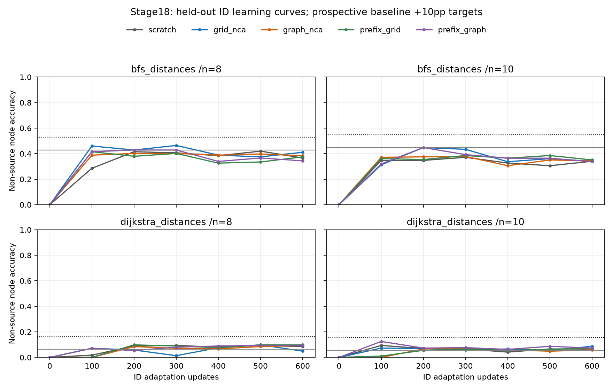

# Stage18: exploratory ID learning acceleration

Started 31 October 2026; completed 1 November 2026. New CPU task-adaptation fits, with imported T4
PPT/language costs. **All five arms are right-censored: this budget provides no measured time-to-target speedup. Undefined ratios are not evidence of equality, graph harm or impossibility.** No earlier failed calibration, synthetic
readiness or OOD/confirmation eligibility is changed.

## Prospective target and matched experiment

Plan `1477e7887baea612119c09717242061d000c7c1a59df44407a3c8f6e24767076` and [frozen protocol](FROZEN_PROTOCOL.md) precede the
first new update. User authorized this exploratory test despite the separately
failed original readiness bridge. It measures downstream ID TASK ADAPTATION
after identical language stages, not language-stage convergence or GNN runtime.

Five original stage13 step0 starts retain full learned heads and fresh AdamW.
The shared architecture, tokenizer, masks/objective, data/order, batch, update
budget and LR schedule are fixed across graph/grid/scratch/both prefix controls.
A new ID resample uses train512/dev128, sizes8/10, BFS/Dijkstra, cyclic-ER family;
its assessment count isZERO. No OOD rows or official language test are generated
or evaluated. The source-aware marginal control is fitted to training labels
only; known source outputs zero, other nodes get that task/size's training mode.

The primary target requires >=10pp advantage on unconditional NON-SOURCE node
accuracy in EVERY cell, >=95% pooled vector validity and complete coverage:

| Task | Size | Frozen baseline correct/nodes | Required accuracy |
| --- | --- | --- | --- |
| bfs_distances | 8 | 96/224 (42.86%) | 52.86% |
| bfs_distances | 10 | 129/288 (44.79%) | 54.79% |
| dijkstra_distances | 8 | 14/224 (6.25%) | 16.25% |
| dijkstra_distances | 10 | 16/288 (5.56%) | 15.56% |

This is a new exploratory semantic target, not retrospective success under the
old80% exact-vector calibration. Invalid vectors are wrong on every node; source
zeros cannot satisfy the non-source criterion. Teacher scores supply gold earlier
answers and token accuracy is not node accuracy. All140 cell rows preserve both.

## ID curves and observed/censored crossings

Every arm completes600 updates and all seven scheduled evaluations, even if it
attains a target earlier. First observed crossing is primary, with no interpolation
or checkpoint selection. Next-observation sustained crossing is a separately
reported sensitivity, including any later regression. Step0 success would be
pre-existing competence, not infinite acceleration. Unreached stays censored.

| Arm | First crossing update | Input tokens to target | CPU adaptation elapsed seconds to target | Final non-source cells: BFS8/BFS10/Dijkstra8/Dijkstra10 | Final exact vectors |
| --- | --- | --- | --- | --- | --- |
| scratch | not reached; censored600 | unreached | unreached | 36.61% / 34.03% / 8.48% / 6.60% | 0.00% |
| grid_nca | not reached; censored600 | unreached | unreached | 41.07% / 34.03% / 4.91% / 8.68% | 0.00% |
| graph_nca | not reached; censored600 | unreached | unreached | 38.39% / 34.38% / 9.38% / 5.90% | 0.00% |
| prefix_grid | not reached; censored600 | unreached | unreached | 37.50% / 35.07% / 9.82% / 7.29% | 0.00% |
| prefix_graph | not reached; censored600 | unreached | unreached | 34.38% / 33.68% / 9.38% / 7.29% | 0.00% |

Individual semantic cell targets met: 0/140 observed cell points.
This retains every declared checkpoint and cell, without selecting an endpoint.

Lines connect recorded observations only; coincident curves can overlap. Gray
lines show the fixed baseline; dotted black lines show its +10pp target. All
four cells plus the validity requirement must pass at the SAME checkpoint.
See [complete results](results.json), [140 cell rows](cells.csv) and
[summary](summary.json) for exact/format/whole-node/source/hop/signed/first-error
scores, teacher NLL/digit/other counters, actual exposures and all timing axes.

Graph contrasts retain BOTH required controls, plus scratch and prefix_grid:

| Reference for graph | Update speedup | Input-token speedup | Interpretation |
| --- | --- | --- | --- |
| grid_nca | undefined | undefined | at_least_one_right_censored |
| prefix_graph | undefined | undefined | at_least_one_right_censored |
| scratch | undefined | undefined | at_least_one_right_censored |
| prefix_grid | undefined | undefined | at_least_one_right_censored |

One inherited PPT/language initialization cohort and a new ID sample are not
independent paired rule/topology replicates. No p-values, CI, equivalence,
positive confirmation or graph no-effect conclusion is inferred. Full continuous
curves remain reported even if the primary time-to-target endpoint is censored.

## Imported PPT, generation and language costs

All arms inherit2000 language updates /8192000 text tokens with identical original
head initialization, data order and scheduler. Costs below are IMPORTED Tesla T4
seconds, not new GPU measurements. The entire paired preparation cost is charged
to each synthetic arm as in v4, not an isolated graph-generator throughput figure.

| Arm | PPT updates/tokens | PPT train/stage seconds | Paired generation/preparation seconds | Language stage seconds | Original cumulative seconds |
| --- | --- | --- | --- | --- | --- |
| scratch | 0 / 0 | 0.000 / 0.000 | 0.000 / 0.000 | 481.137 | 487.963 |
| grid_nca | 1000 / 4,096,000 | 119.374 / 127.347 | 15.451 / 16.826 | 480.726 | 631.786 |
| graph_nca | 1000 / 4,096,000 | 121.305 / 129.096 | 15.451 / 16.826 | 481.155 | 633.964 |
| prefix_grid | 1000 / 4,096,000 | 121.476 / 129.323 | 15.451 / 16.826 | 481.445 | 634.472 |
| prefix_graph | 1000 / 4,096,000 | 121.267 / 129.014 | 15.451 / 16.826 | 481.142 | 633.915 |

Language stage seconds include its validation; original cumulative totals also
include text/shared preparation and setup. Do not sum these overlapping columns
again. Scratch has no PPT. Original exclusions include queue/startup/calibration,
initial snapshot and final checkpoint verification/export/archives; unmeasured
costs are not assumed zero. Full input evidence and extracted [costs](costs.json)
are hash-bound before fitting. Token sums are stage ledgers, not equal FLOPs/$.
Historical PPT-gate flags in raw cost summaries are retained verbatim; they
refer to the weaker v4 gate, not the later stronger readiness check that failed.

Full600-update budget accounting, whether or not the target was reached:

| Arm | New CPU train seconds | New CPU eval seconds | PPT+language+adaptation input tokens | Accounted original GPU cumulative + new CPU elapsed seconds |
| --- | --- | --- | --- | --- |
| scratch | 292.316 | 225.824 | 8,754,823 | 1008.649 |
| grid_nca | 231.219 | 186.018 | 12,850,823 | 1051.201 |
| graph_nca | 251.213 | 191.175 | 12,850,823 | 1078.531 |
| prefix_grid | 284.634 | 214.077 | 12,850,823 | 1135.524 |
| prefix_graph | 316.001 | 278.893 | 12,850,823 | 1231.410 |

The last column is a component execution-cost account across DIFFERENT hardware,
not controlled end-to-end throughput, deployment cost recovery or a target-crossing
time for censored runs. Adaptation elapsed includes evaluation/checkpoint IO;
arms run sequentially in a fixed order, without a controlled hardware crossover.
It starts after CPU model/optimizer construction. Train and eval timers are
separated. Setup/teardown and shared preparation remain in logged command wall
times, without a fabricated per-arm allocation. New preparation/replay/export times are
in the append-only log. No PPT cost is silently omitted or amortized over seeds.

## Verification and next decision

Separate same-code replay reloads35 model/optimizer checkpoints and exactly
reproduces4480 new generations/teacher scores, baseline/semantic decisions,
crossings/censoring/contrasts, initial identities, optimizer updates and actual
order/LR/token counts. Original runtime observations are retained, not expected
to repeat bit-for-bit. Replay is not a second fit or independent neural inference.
Independent parsing/count and public-only data/order/baseline/cost/score checks
complement it. [Usage](../../ACCEL_V18_USAGE.md) gives reproducible commands.

[Provenance](PROVENANCE.json) binds60 exact evidence copies. Private weights,
optimizer states, raw caches and order arrays remain excluded. The exact result
JSON alone has a bounded12MB publication allowance to retain all cases; other
artifact exclusions remain. New scientific updates:3000 CPU task-adaptation.
New PPT/language/GPU/OOD/official-test evaluations:ZERO. No paid/remote training,
email, push or external publication. No altered salt, relaxed margin, dropped arm,
extra update or selected checkpoint follows the observed result.

Preserve this exploratory endpoint. A later study needs its own frozen treatment,
target and budget; this run does not automatically open OOD. Original categorical/
random-rule readiness, eligible starts, fresh independent paired cohorts,
identical full language/adaptation stages, all controls, ID-only selection,
predeclared OOD targets/censoring/multiplicity and full costs remain necessary
under the separate confirmation protocol. No current result proves a universal
GraphNCA advantage, equivalence or impossibility.
