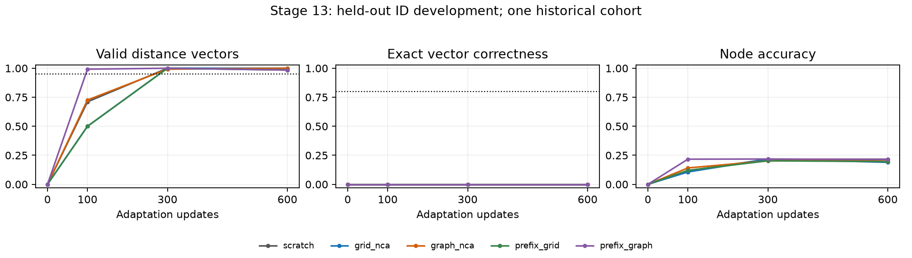

# Stage 13: identical ID algorithmic adaptation

Completed local CPU development calibration, 30 October 2026.

**The fixed calibration criterion fails. No new OOD predictions are made; comparing OOD learning acceleration remains gated. Preserve this endpoint and all arms without extra updates or relaxed targets.** This tests a task-interface/trainability prerequisite, not a
confirmatory graph-specific PPT effect. It uses one historical cohort whose
original stronger synthetic readiness remains failed. No new language stage,
PPT stage, remote job or GPU measurement is performed.

## Frozen design and results

Plan SHA-256: `9e18f7f90def47c453f29847244d7715ebab48cdbf0d267a23bbde66957d5b5e`.
The [frozen protocol](FROZEN_PROTOCOL.md) precedes fitting. Five v4 cohort-59 final
language models share their historical 2,000-update /8,192,000-token language
stage, original head initialization, actual data order and LR schedule. Their
complete learned states enter adaptation unchanged, including inherited tied
heads. Equal head policy preserves different post-language learned weights;
no head is reset or compared as if the trained heads were equal.

All arms receive 600 NEW full-model AdamW adaptation updates, batch 8, the same
512 ID training examples and actual sampled order, optimizer initialization,
warmup/cosine LR schedule and 128-example ID-development evaluation. New stage
cost is separate from historical PPT/language. No additional language budget
is substituted for PPT or algorithmic adaptation.

Each arm sees exactly 562,855 unpadded
input tokens, 96,016 answer/EOS
targets and 691,560 padded input
positions. The full study performs 3,000
scientific updates. Software fixture updates are separate. Prompt and padding
targets are masked, but all prompt tokens condition answer predictions. Gradient
checks verify the selective output projection against the ordinary full LM.

Final generated answers at update 600:

| Arm | ID exact match | Valid vectors | Node accuracy | Train-probe NLL | ID-dev NLL | Criterion |
| --- | ---: | ---: | ---: | ---: | ---: | --- |
| scratch | 0.00% | 99.22% | 21.60% | 0.7587 | 0.9768 | fail |
| grid_nca | 0.00% | 100.00% | 18.95% | 0.7538 | 0.9927 | fail |
| graph_nca | 0.00% | 100.00% | 21.07% | 0.7447 | 0.9983 | fail |
| prefix_grid | 0.00% | 98.44% | 19.59% | 0.7853 | 0.9669 | fail |
| prefix_graph | 0.00% | 98.44% | 21.37% | 0.7492 | 0.9740 | fail |

The criterion requires every arm to have at least 80% exact match pooled AND in
each task/size cell, 95% pooled valid vectors, and 100% coverage. Do not substitute
teacher-forced NLL or node accuracy for generated-vector correctness. Training
uses answer+EOS targets; inference is prompt-only, unconstrained greedy output
with the original tokenizer, vocabulary, context and decoder. Every ID prompt
plus generation budget fits; no task-specific logit mask or truncation is used.

| Arm | Task | Nodes | Exact match | Valid vectors |
| --- | --- | ---: | ---: | ---: |
| scratch | bfs_distances | 8 | 0.00% | 100.00% |
| scratch | bfs_distances | 10 | 0.00% | 96.88% |
| scratch | dijkstra_distances | 8 | 0.00% | 100.00% |
| scratch | dijkstra_distances | 10 | 0.00% | 100.00% |
| grid_nca | bfs_distances | 8 | 0.00% | 100.00% |
| grid_nca | bfs_distances | 10 | 0.00% | 100.00% |
| grid_nca | dijkstra_distances | 8 | 0.00% | 100.00% |
| grid_nca | dijkstra_distances | 10 | 0.00% | 100.00% |
| graph_nca | bfs_distances | 8 | 0.00% | 100.00% |
| graph_nca | bfs_distances | 10 | 0.00% | 100.00% |
| graph_nca | dijkstra_distances | 8 | 0.00% | 100.00% |
| graph_nca | dijkstra_distances | 10 | 0.00% | 100.00% |
| prefix_grid | bfs_distances | 8 | 0.00% | 93.75% |
| prefix_grid | bfs_distances | 10 | 0.00% | 100.00% |
| prefix_grid | dijkstra_distances | 8 | 0.00% | 100.00% |
| prefix_grid | dijkstra_distances | 10 | 0.00% | 100.00% |
| prefix_graph | bfs_distances | 8 | 0.00% | 100.00% |
| prefix_graph | bfs_distances | 10 | 0.00% | 100.00% |
| prefix_graph | dijkstra_distances | 8 | 0.00% | 96.88% |
| prefix_graph | dijkstra_distances | 10 | 0.00% | 96.88% |

First observed pooled 80% ID-development exact-match crossing (no interpolation):

| Arm | Update |
| --- | --- |
| scratch | not reached by 600 (censored) |
| grid_nca | not reached by 600 (censored) |
| graph_nca | not reached by 600 (censored) |
| prefix_grid | not reached by 600 (censored) |
| prefix_graph | not reached by 600 (censored) |

The [complete curves and cells](id_cells.csv) retain updates 0,100,300,600.
No ratio or significance test is inferred from censored single-cohort crossings.
No checkpoint is selected using OOD. No additional OOD data is generated or parsed into examples by fitting; no OOD
labels/prompts condition training or selection. The inherited stage 12 integrity
verifier DOES rehash its prior assessment bytes. The frozen protocol's literal
"not read" wording overstates this boundary; preserve it and read the
[input-integrity clarification](../../ADAPTATION_V13_INTEGRITY_CLARIFICATION.md).
The reserved official language test remains untouched.

Lines use the four observed evaluations; coincident lines overlap. Dotted lines
are the frozen pooled format/exact targets. The per-cell exact criterion still
applies. There are no independent-cohort confidence intervals in this pilot.

## Interpretation, evidence and costs

Valid format and task correctness measure different things. A valid incorrect
vector demonstrates interface learning only. NLL includes formatting/EOS and
teacher forcing; it cannot establish algorithm execution or graph mechanism.
The fixed training probe is the FIRST 64 training examples: 32 eight-node base
graphs across both tasks. Development includes 8- AND 10-node graphs, so their
pooled NLL difference also changes composition and must NOT be described as a
matched generalization gap. Per-task/size generation metrics remain separate.

Replay reopens all 20 initial/intermediate/final
checkpoints and exactly reproduces 2,560
generated answers, token IDs, stops, scores and train/development NLL. Every final
optimizer tensor has 600 steps; initial checkpoints have fresh optimizer state.
This is separate same-code replay, not independent fitting or an independent
neural loss implementation. Independent Floyd-Warshall labels and inherited
structural split/cut exclusions are checked before fitting and during replay.

The [provenance](PROVENANCE.json) binds 32 exact evidence copies.
Weights, optimizer states, raw graph datasets, private correspondence and caches
remain private; hashes identify retained private artifacts. Costs: summed CPU
update timers 1172.577 seconds; development generation/
NLL timers 495.863 seconds. These exclude source
hashing, model construction/checkpoint IO and verification; full command wall
times remain in the append-only log. Sequential order and machine load can affect
timing. Historical GPU PPT/language/generation costs remain imported evidence,
not newly measured or zero. No GPU, training-speedup or cost-recovery claim follows.

Readers can regenerate the exact ID train/development bytes and reproduce all
2,560 exported answer scores/cells from public files without weights, network,
email or tokenizer cache using `scripts/reproduce_adaptation_v13_scores.py`.
See the [usage guide](../../ADAPTATION_V13_USAGE.md). That independent invocation
reproduces scoring/data identities; it is not neural inference, NLL or training.

## Next decision

The fixed calibration criterion fails. No new OOD predictions are made; comparing OOD learning acceleration remains gated. Preserve this endpoint and all arms without extra updates or relaxed targets.

Before another fit, use the retained checkpoints for a separately frozen
training-versus-development generated-error audit, with matched task/size probes.
This distinguishes poor fitting from held-out generalization more directly than
the composition-mismatched NLL means. Freeze any next treatment separately and
keep all controls. A real
GraphNCA learning-acceleration study still requires the categorical/random-rule
readiness bridge, eligible initializations, fresh independent paired cohorts,
identical full language and adaptation stages, ID-only selection, predeclared
OOD targets/censoring/multiplicity and total costs. Graph must beat BOTH grid
and its matched prefix shuffle, with scratch and prefix-grid retained.
Stage 11 binary confirmation, stage 12 zero-shot floor and all historical negative
results are unchanged. No email, publication, push or remote/paid training occurs.
