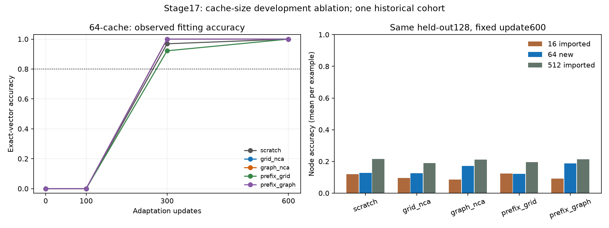

# Stage 17: intermediate 64-example cache at 600 updates

Completed local CPU development experiment, 31 October 2026.

**The primary cache-fitting criterion PASSES for all five arms.** Held-out competence is
reported separately below. All five new models still have 0/128 exact held-out answers; none passes full-ID competence. Neither a cache-fitting success nor a mixed endpoint
establishes GraphNCA acceleration, unseen-rule learning, cost recovery or graph
equivalence. Original random-rule readiness and the categorical bridge remain
failed/required; OOD and further full language suites remain gated.

## Frozen treatment and identical starts

Plan `6b52c649bdfab7fd8d43d11a308e62606a0e285a10f9210db2a502a629195028` and [frozen protocol](FROZEN_PROTOCOL.md) precede the
first new update. The only declared training change is cache size: 64 examples
(32 graphs, 16 per size, both BFS/Dijkstra tasks). The SAME outcome-blind salted
ranking nests common16 inside cache64 inside the old training128/512. All are
inspected development evidence from one historical cohort, not fresh confirmation.

All five models restart from the SAME full stage13 step0 language endpoints,
including learned tied heads and fresh optimizers. Exact source/state identities
are retained. Architecture, tokenizer, prompt/answer/EOS format, context, answer-
only loss/masks, full-model fp32 CPU AdamW, clipping, two threads, determinism,
seed, batch8, warmup/cosine and 600 updates match the original procedure. Every
arm receives the same actual order. No model continues an older adapted fit.

| Per arm | Imported16 | New64 | Imported512 |
| --- | ---: | ---: | ---: |
| Examples / graphs | 16 /8 | 64 /32 | 512 /256 |
| Updates / presentations | 600 /4800 | 600 /4800 | 600 /4800 |
| Presentations per example | 300 | 75 | 9–10 |
| Unpadded input tokens | 571,200 | 561,300 | 562,855 |
| Supervised answer/EOS targets | 96,000 | 96,000 | 96,016 |
| Padded input positions | 708,488 | 692,880 | 691,560 |

Cache content/diversity/repetition and lengths change together. Fixed updates do
not mean equal tokens, FLOPs or time, or isolate repetition causally. Original
reference costs are imported, not zero; no reference fit/inference is newly run.

## Fixed endpoints and matched cases

The primary all-arm criterion requires >=80% exact in EVERY cache64 task/size
cell (>=13/16), >=95% pooled validity and full coverage at update600. Transient
pooled crossings do not replace it. No best checkpoint or omitted seed/control.
Each endpoint retains the four fixed cache evaluations plus dev only at600.

| Arm | Four cache64 cells | Cache exact | Valid vectors | Imported512, SAME64 exact | Final criterion |
| --- | --- | --- | --- | --- | --- |
| scratch | bfs8:16/16, bfs10:16/16, dijkstra8:16/16, dijkstra10:16/16 | 100.00% | 100.00% | 0.00% | pass |
| grid_nca | bfs8:16/16, bfs10:16/16, dijkstra8:16/16, dijkstra10:16/16 | 100.00% | 100.00% | 0.00% | pass |
| graph_nca | bfs8:16/16, bfs10:16/16, dijkstra8:16/16, dijkstra10:16/16 | 100.00% | 100.00% | 0.00% | pass |
| prefix_grid | bfs8:16/16, bfs10:16/16, dijkstra8:16/16, dijkstra10:16/16 | 100.00% | 100.00% | 0.00% | pass |
| prefix_graph | bfs8:16/16, bfs10:16/16, dijkstra8:16/16, dijkstra10:16/16 | 100.00% | 100.00% | 0.00% | pass |

Three-way exact-vector comparison on the SAME common16 examples. This is a
training subset for ALL variants, not a held-out probe. New64 common scores are
derived by exact final64 case/counter subsetting without an extra model forward.

| Arm | Imported16 | New64 | Imported512 |
| --- | --- | --- | --- |
| scratch | 100.00% | 100.00% | 0.00% |
| grid_nca | 100.00% | 100.00% | 0.00% |
| graph_nca | 100.00% | 100.00% | 0.00% |
| prefix_grid | 100.00% | 100.00% | 0.00% |
| prefix_graph | 100.00% | 100.00% | 0.00% |

Three-way exact-vector comparison on the SAME full held-out128 examples:

| Arm | Imported16 | New64 | Imported512 | New64 full-ID criterion |
| --- | --- | --- | --- | --- |
| scratch | 0.00% | 0.00% | 0.00% | fail |
| grid_nca | 0.00% | 0.00% | 0.00% | fail |
| graph_nca | 0.00% | 0.00% | 0.00% | fail |
| prefix_grid | 0.00% | 0.00% | 0.00% | fail |
| prefix_graph | 0.00% | 0.00% | 0.00% | fail |

The unchanged full-ID criterion requires >=26/32 exact in every cell, >=95%
pooled validity and full coverage. Cache-fit and full-ID decisions remain
separate, and neither alone satisfies the separately required synthetic gate.

All fixed development continuous metrics, using the original node-example mean
and teacher task/size-cell means (not token-micro rates):

| Arm | Cache variant | Valid vectors | Generated node accuracy | Teacher digit | Teacher other | Teacher answer/EOS NLL |
| --- | --- | --- | --- | --- | --- | --- |
| scratch | 16 imported | 66.41% | 12.03% | 20.18% | 93.53% | 2.5892 |
| scratch | 64 new | 59.38% | 12.81% | 23.69% | 97.27% | 2.0393 |
| scratch | 512 imported | 99.22% | 21.60% | 27.87% | 99.93% | 0.9764 |
| grid_nca | 16 imported | 53.12% | 9.65% | 20.43% | 94.57% | 2.6205 |
| grid_nca | 64 new | 66.41% | 12.54% | 21.39% | 96.56% | 2.1876 |
| grid_nca | 512 imported | 100.00% | 18.95% | 24.36% | 100.00% | 0.9912 |
| graph_nca | 16 imported | 51.56% | 8.61% | 19.47% | 91.97% | 2.8112 |
| graph_nca | 64 new | 87.50% | 17.09% | 21.25% | 99.27% | 2.1340 |
| graph_nca | 512 imported | 100.00% | 21.07% | 28.09% | 99.93% | 0.9983 |
| prefix_grid | 16 imported | 62.50% | 12.34% | 20.59% | 93.16% | 2.6779 |
| prefix_grid | 64 new | 67.19% | 12.17% | 23.14% | 96.95% | 2.0932 |
| prefix_grid | 512 imported | 98.44% | 19.59% | 25.47% | 99.92% | 0.9660 |
| prefix_graph | 16 imported | 53.91% | 9.18% | 19.59% | 95.04% | 2.7199 |
| prefix_graph | 64 new | 97.66% | 18.71% | 21.45% | 99.79% | 2.1801 |
| prefix_graph | 512 imported | 98.44% | 21.37% | 27.52% | 99.92% | 0.9713 |

Answer/EOS NLL improves from imported16 to new64 in every arm. The imported512 reference still has lower NLL and higher node accuracy than new64 in every arm. Node-score changes relative to imported16 are not uniformly positive.
These are descriptive same-case changes in one cohort, not independent
replications or a sufficient full-ID competence result.

Invalid vectors count wrong on every unconditional node/source/hop metric.
Teacher scores supply gold earlier answers and digit tokens may span punctuation;
their accuracy is not free-generation semantic accuracy. [All 220 cell rows](cells.csv)
retain source/hop/signed and token counters, exact case coverage and all three
variants. [Complete results](results.json) retain per-case first-error details.
The small16 reference has NO full64 measurement on the additional48 cases:
those cases are absent, never silently scored zero. Imported512 alone supplies
the full64 same-case reference. References remain distinct from new measurements.

First observed pooled80% cache crossing at the frozen steps, without interpolation:

| Arm | First observed update |
| --- | --- |
| scratch | 300 |
| grid_nca | 300 |
| graph_nca | 300 |
| prefix_grid | 300 |
| prefix_graph | 300 |

Lines connect recorded points only; overlapping curves can coincide. The pooled
line is not the final per-cell decision. Bars show fixed held-out node accuracy.
One inherited cohort/two correlated tasks per graph do not support independent-
cohort confidence intervals, graph equivalence or confirmatory speedup ratios.

## Replay, provenance and costs

Separate same-code replay reloads all20 new model/optimizer checkpoints and
reproduces all1920 new cache/development generations and teacher scores,
common16 subsetting, original complete tensor/optimizer starts, step counts,
actual batch order/LR/token exposure, fixed decisions and both reference subsets.
It is not another fit or independently implemented neural inference. Independent
decimal parsing/cell accounting and public-only score reproduction complement it.

[Provenance](PROVENANCE.json) binds72 exact copies of the new evidence and
explicitly imported reference records. Private weights/optimizer states, order
arrays and raw caches stay excluded. Public replay reconstructs selected data/
labels/order, references and generated scores without private weights/data,
tokenizer cache or network. Imported teacher counters alone do not reproduce
neural logits; see [usage](../../CACHE_V17_USAGE.md).

New scientific CPU task-adaptation updates:3000. Imported reference updates:6000.
New PPT/language updates, GPU measurements and OOD predictions:ZERO. Summed new
CPU update timers:1163.269s; evaluations:403.728s.
Timers exclude provenance, IO and separate replay; command wall durations remain
in the append-only log. Local regression fixtures briefly overlap the last fit;
these CPU timers are observed costs, not matched throughput/cost-recovery claims.
Inherited provenance can rehash old assessment bytes. New fitting reads only
declared ID caches; public reconstruction can regenerate unused synthetic OOD
rows in memory, as declared prospectively. No official language test, paid/remote
job, email, push or external publication occurs.

## Next decision

Preserve this fixed endpoint and all controls. Interpret fitting and held-out
prediction separately from these tables; do not discard an arm, change the salt,
extend a fit, relax a target or select a checkpoint after observing outcomes.
Before any further treatment, inspect the saved per-case/conditional errors and
actual optimization traces under a separately declared diagnostic. A later
training-budget change must hold cache/data fixed; do not combine it with a
format/objective/topology/serialization change and attribute the result uniquely.

Any graph-specific transfer confirmation still needs eligible synthetic starts,
the categorical/random-rule bridge, fresh paired rule/data/topology cohorts,
identical full language/adaptation stages, all five controls, ID-only selection,
predeclared OOD criteria/censoring/multiplicity and total costs. No endpoint here
automatically authorizes a new full language/OOD suite.
