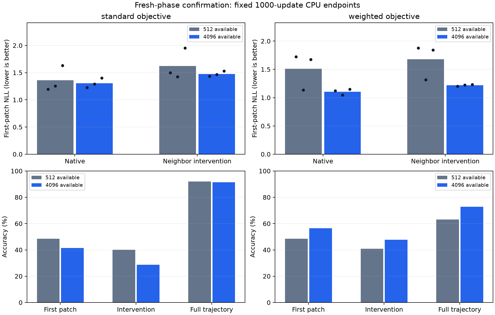

# Stage 11: fresh-phase confirmation

Completed on local CPU. **Weighted primary confirmation:
True**. Standard stratum:
**False**; broader both-objective
criterion: **False**. Language remains gated.
All 24 endpoints were fitted anew; no historical endpoint enters this comparison.

The [protocol](FROZEN_PROTOCOL.md), [plan](plan.json) and
[receipt](plan_receipt.json) froze before fitting. Plan SHA-256:
`f66ad56b5ef509c188f33d92cefc4032ee6979e658aff7259bf8685a49720a4a`. This is a prospective confirmation of the weighted
hypothesis generated by [stage 10](../diversity_v10_run1/REVIEW.md), whose
both-objective primary remains failed. Making weighted confirmation primary in
this separate declaration does not replace that earlier outcome.

## Fresh data, unchanged treatment

Exclude 4926 historical joint phase classes
from controlled binary stages 6–10, including every old intervention partner.
Using the frozen seed, reserve 128 assessment states and their 128 changed
partners first, then select 64 development and 4096 training states. All joint
classes are disjoint across these groups and from historical classes. All 128
intervention pairs are eligible by construction, rather than selected by score.
There is no spatial-translation-disjointness claim. The small cache is the exact
first 512 rows of the larger coherent AND prefix-shuffled arrays.

Three fresh initialization seeds share ONE new data split. These are paired
initialization replicates, not independently sampled rule/data cohorts. Within
each seed, eight fits share actual saved initial weights and fresh Adam states.
Retain the known binary spatial rule, 4x4 periodic grid, eight frames, 2x2 patch
serializer, alphabet 18/context 47, six-layer/192-wide/four-head backbone,
standard factor-one versus normalized first-transition factor-six objectives,
and original optimizer/schedule/batch settings. Each model receives 1000 updates,
188000 input tokens and 168000 supervised targets. Only fresh data and seeds
change relative to the declared diversity comparison.

Uniform replacement sampling makes 4000 row draws per fit. Four arms within
each seed/cache use the exact same sampled indices. Cache sizes share RNG seed
and draw count, but changing the sampling bound changes selected examples.

| Seed | Distinct rows drawn from 512 | Distinct rows drawn from 4096 |
| --- | ---: | ---: |
| 179 | 512 | 2561 |
| 193 | 512 | 2558 |
| 211 | 512 | 2564 |

## Frozen comparisons

The weighted primary requires ALL three coherent seeds to improve native AND
intervention first-patch NLL by at least 0.01, while the larger-cache model
retains frequency and ordering advantages of at least 0.01 on full trajectories.
The identical standard comparison is retained separately. The broader criterion
requires BOTH objective strata. These fixed criteria are not a significance test.
Positive improvements favor the larger cache. No seed, threshold, objective,
budget or final checkpoint was changed after assessment.

| Objective | Seed | Native NLL improvement | Intervention NLL improvement | Larger-cache readiness | All criteria |
| --- | ---: | ---: | ---: | --- | --- |
| standard | 179 | -0.032516 | 0.065690 | Pass | Fail |
| standard | 193 | -0.038700 | -0.042394 | Pass | Fail |
| standard | 211 | 0.228457 | 0.423946 | Pass | Pass |
| weighted | 179 | 0.600698 | 0.677305 | Pass | Pass |
| weighted | 193 | 0.089493 | 0.093019 | Pass | Pass |
| weighted | 211 | 0.527476 | 0.608570 | Pass | Pass |

Coherent-trained means across the three initialization seeds:

| Objective | Cache | First NLL | First accuracy | Intervention NLL | Intervention accuracy | Both correct | Full NLL | Full accuracy | Readiness |
| --- | ---: | ---: | ---: | ---: | ---: | ---: | ---: | ---: | ---: |
| standard | 512 | 1.359112 | 48.44% | 1.624712 | 40.10% | 17.45% | 0.296595 | 92.06% | 3/3 |
| weighted | 512 | 1.511389 | 48.44% | 1.678323 | 40.89% | 21.88% | 1.080736 | 63.19% | 3/3 |
| standard | 4096 | 1.306698 | 41.41% | 1.475631 | 28.65% | 6.77% | 0.266482 | 91.45% | 3/3 |
| weighted | 4096 | 1.105500 | 56.51% | 1.218692 | 47.66% | 25.52% | 0.829883 | 72.72% | 3/3 |

Bars show means; NLL dots show individual seeds. These are fixed-budget final
endpoints, not time-to-target learning curves. First-patch predictions see only
the initial frame and next start marker. The intervention flips initial cell
(0,3), outside the target patch, changing the correct target patch's bit zero.
Paired correctness requires both native and changed predictions correct.

## Shuffled controls and frequency baseline

Shuffle-trained checkpoints scored on coherent assessment trajectories:

| Objective | Cache | First NLL | First accuracy | Intervention NLL | Intervention accuracy | Both correct | Full NLL | Full accuracy | Readiness |
| --- | ---: | ---: | ---: | ---: | ---: | ---: | ---: | ---: | ---: |
| standard | 512 | 2.223963 | 17.19% | 2.443469 | 8.33% | 1.82% | 2.011317 | 22.96% | 0/3 |
| weighted | 512 | 2.277926 | 19.79% | 2.515775 | 12.76% | 3.39% | 2.074404 | 22.67% | 0/3 |
| standard | 4096 | 2.173592 | 16.93% | 2.408118 | 8.33% | 0.26% | 1.961392 | 20.80% | 0/3 |
| weighted | 4096 | 2.157341 | 16.67% | 2.377188 | 8.85% | 0.26% | 1.996718 | 21.15% | 0/3 |

| Objective | Seed | Shuffled first NLL diversity gain | Coherent gain minus shuffled gain |
| --- | ---: | ---: | ---: |
| standard | 179 | 0.029361 | -0.061876 |
| standard | 193 | 0.025134 | -0.063834 |
| standard | 211 | 0.096619 | 0.131838 |
| weighted | 179 | 0.134364 | 0.466334 |
| weighted | 193 | 0.085729 | 0.003764 |
| weighted | 211 | 0.141663 | 0.385814 |

These contrasts are descriptive. A coherent-model gain alone does not establish
a dynamics-specific cause. Full-trajectory readiness can conceal poor first
predictions; retained shuffled-control readiness should be assessed alongside
the actual first-transition errors. This known rule is involutive: a state
returns after two updates, so full-trajectory targets contain repeated frames.
The short-prefix and neighbor-intervention probes avoid conditioning on those
later repetitions. This observation does not identify a learned circuit.
A separate causal frequency baseline is
calibrated on each training cache using the unchanged train-only policy.

| Training cache | Assessment causal frequency NLL | Concentration |
| ---: | ---: | ---: |
| 512 | 1.934132 | 1 |
| 4096 | 1.934212 | 1 |

Exact priors, concentration trials and coherent/shuffled scores remain in
[results](results.json) and the [full-cell CSV](full_cells.csv).
In the paired CSV, `passed` is the complete comparison and `readiness_passed`
is the trajectory gate. The earlier stage 10 CSV has a documented
[column-collision caveat](../../STAGE10_CSV_CAVEAT.md); its JSON/review decision
remains correct and its original evidence is preserved.

## Training versus held-out probes

| Objective | Cache | Probe | First NLL | First accuracy | Four-patch NLL | Four-patch accuracy | Mean actually drawn probe rows |
| --- | ---: | --- | ---: | ---: | ---: | ---: | ---: |
| standard | 512 | anchor | 0.865827 | 73.83% | 0.762844 | 79.23% | 512.00 |
| standard | 512 | extension | 1.497963 | 47.07% | 1.702847 | 41.41% | 0.00 |
| standard | 512 | development | 1.516714 | 47.92% | 1.667688 | 42.06% | 0.00 |
| standard | 512 | assessment | 1.359112 | 48.44% | 1.587143 | 44.40% | 0.00 |
| weighted | 512 | anchor | 0.657689 | 87.50% | 0.618354 | 88.28% | 512.00 |
| weighted | 512 | extension | 1.624301 | 44.01% | 1.597491 | 45.67% | 0.00 |
| weighted | 512 | development | 1.593237 | 45.31% | 1.582272 | 46.09% | 0.00 |
| weighted | 512 | assessment | 1.511389 | 48.44% | 1.529975 | 47.85% | 0.00 |
| standard | 4096 | anchor | 1.397303 | 33.66% | 1.400850 | 39.11% | 323.67 |
| standard | 4096 | extension | 1.351978 | 37.30% | 1.401276 | 39.99% | 316.00 |
| standard | 4096 | development | 1.391202 | 33.33% | 1.441223 | 35.81% | 0.00 |
| standard | 4096 | assessment | 1.306698 | 41.41% | 1.396449 | 40.17% | 0.00 |
| weighted | 4096 | anchor | 1.164190 | 51.76% | 1.203727 | 51.35% | 323.67 |
| weighted | 4096 | extension | 1.132829 | 55.73% | 1.196626 | 52.83% | 316.00 |
| weighted | 4096 | development | 1.177901 | 49.48% | 1.251951 | 46.35% | 0.00 |
| weighted | 4096 | assessment | 1.105500 | 56.51% | 1.180909 | 54.88% | 0.00 |

Anchor and extension each contain 512 rows, development 64 and assessment 128.
Anchor is the small cache; extension is the first 512 additional large-cache
rows. Scores include all probe rows, not only those drawn. Retain actual exposure
masks and drawn/undrawn subset statistics, with null for empty subsets. This is
not an exhaustive 4096-row training assessment. Later first-transition patches
are teacher-forced; they see earlier true patches. Marker loss is separate.
Short/long first-patch scores agree within 1e-5 with identical correctness.

## Verification, costs and next decision

All 54 full-trajectory, 108 fit-probe and 27 intervention cases replay exactly
after reopening three initial and 24 final checkpoints in a separate invocation.
The original scorer functions are unchanged. This is scorer replay, not an
independent implementation of the loss or a rerun of fitting. Final optimizer
step counts, actual initial states, input/source/receipt identities and sampled
indices are checked. [Verification](verification.json), [summary](summary.json),
four CSVs and nine per-seed raw files retain every vector and decision.
The [provenance manifest](PROVENANCE.json) binds 71 exact evidence copies.
Private arrays, weights and optimizer moments remain preserved; compact public
files support accounting audits but neural replay needs those private artifacts.

New fitting totals 24 models, 24,000
updates, 4,512,000 input tokens and 4,032,000 supervised
targets. Recorded per-model CPU timers sum to
27.549 minutes. Generation, source checks,
assessment, replay and software verification add cost. Concurrent local checks
and invocation overhead prevent interpreting these timers as a controlled
throughput comparison. No GPU, language-token speedup or cost recovery is measured.

The initial command failed on a Windows status-file replacement after 21 final
models and 800 updates of the next fit. The separately journaled
[execution recovery](execution_recovery.json) preserves all 21 endpoints and
the interrupted [metrics](execution_interruptions/4096_standard_prefix_211/metrics.jsonl).
Its completed-folder guard and JSON retries leave the frozen numerical body
unchanged. Restarting the unfinished fit from its original initialization
reproduces all recorded non-time metrics through update 800; the remaining two
fits also finish. The [recovery verification](execution_recovery_verification_6950.json)
checks the exact executed helper, unchanged retained weights and all endpoints.
An overlapping alternative preparation stops before fitting and is retained
privately; the [recovery note](../../CONFIRMATION_V11_RECOVERY.md) explains it.

Charge the discarded 800 updates as well: actual training consumes
24,800 updates,
4,662,400 input tokens and
4,166,400 targets. The last
interrupted stage timer records 68.244014
seconds, a lower bound; the failed whole command lasts
1519.694013 seconds. Final-endpoint timers
above exclude this discarded attempt. No extra endpoint is selected or assessed.

The frozen weighted confirmation passes. Plan a separately declared bridge toward interacting categorical rules, changing one task property at a time and retaining both objectives and shuffled controls. This fixed-rule success does not authorize a language suite.

This confirms or rejects one predeclared endpoint hypothesis on a known
interacting binary rule and one fresh split. It does not establish GraphNCA
acceleration, unseen-rule generalization or superiority over standard loss.
Original random-rule checkpoints remain unready. Any future language comparison
needs a separately frozen eligible synthetic configuration, fresh paired cohorts
and an identical full language stage. No official-language-test access, topology/
serializer/budget retuning, remote/paid training, push or publication occurred.
