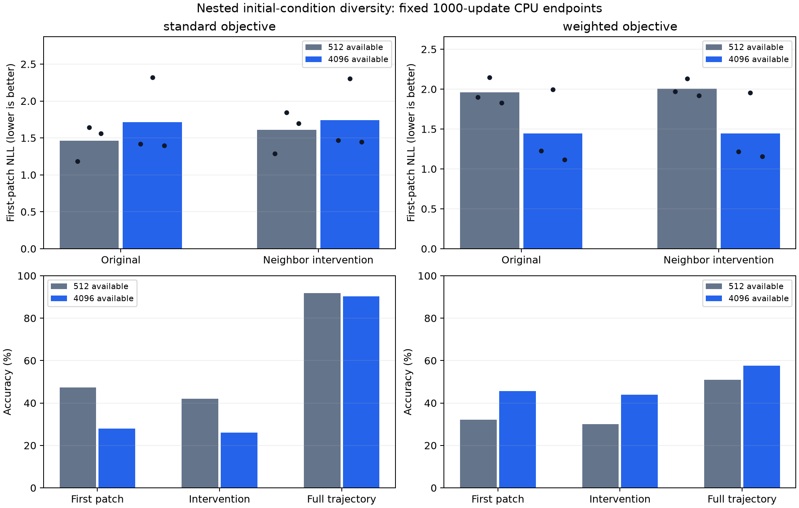

# Stage 10: initial-condition diversity at fixed token exposure

Completed 21 October 2026 on local CPU. **Study-wide primary:
False**. Standard stratum:
**False**; weighted stratum:
**True**. Language remains gated.
Twelve new 4096-condition models are compared with twelve verified imported
512-condition endpoints. No imported control was retrained or relabeled.

[Protocol](FROZEN_PROTOCOL.md), [plan](plan.json) and [receipt](plan_receipt.json)
froze before fitting, with SHA-256:
`833219dd13b85713c34af5b649cfd2693939b1b766e3a3d900933685ac231101`. This is development on previously inspected held-out
data, not fresh confirmation. Earlier [stage 8](../loss_weight_v8_run1/REVIEW.md)
and [stage 9](../fit_v9_run1/REVIEW.md) results remain unchanged.

## The only treatment and actual exposure

Increase available training initial conditions from 512 to 4096. The original
512 coherent trajectories AND prefix shuffles are exact nested rows. New rows
use the first eligible distinct joint-phase representatives from the frozen
permutation. No new row shares an orbit with original train/development/
assessment or any neighbor-flipped assessment state. All 122 eligible neighbor
interventions remain excluded from the larger training set, with the old mask.
The known spatial rule, serializer, alphabet, 4x4 grid, eight frames, context 47,
six-layer/192-wide/four-head model and actual initial weights remain fixed.

Retain standard (factor one) and normalized complete-first-transition sixfold
objectives, each with coherent and matched shuffled training. Adam/reset state,
LR schedule, batch/accumulation and 1000 updates / 188000 input tokens / 168000
supervised targets per model match. All four new arms within each seed use the
same sampled indices. Changing the sampling bound changes actual examples across
cache sizes; only RNG seed and draw count are paired, not identical row identities.

| Seed | Distinct rows drawn from 512 | Distinct rows drawn from 4096 |
| --- | ---: | ---: |
| 131 | 512 | 2532 |
| 149 | 512 | 2533 |
| 167 | 511 | 2558 |

Every model draws 4000 sequences with replacement. Available cache size and
actual observed diversity differ. Increasing cache size changes repetition at
fixed exposure. New coverage is checked against actual training-order digests,
and original 512 digests reproduce historical controls. Do not infer full-cache
fitting from a score on rows that were never drawn.

## Frozen primary comparisons

Require >=0.01 nats improvement in BOTH original first-patch and eligible
intervention NLL for every coherent seed, retaining both unchanged trajectory
readiness margins. Report standard and weighted strata separately; the study-wide
primary requires BOTH strata. These are fixed development criteria, not p-values
or independent rule-cohort evidence. Positive improvements favor the larger cache.

| Objective | Seed | First-patch NLL improvement | Intervention NLL improvement | Larger-cache trajectory readiness | All criteria |
| --- | ---: | ---: | ---: | --- | --- |
| standard | 131 | -0.236307 | -0.180254 | Pass | Fail |
| standard | 149 | -0.675943 | -0.458504 | Pass | Fail |
| standard | 167 | 0.162120 | 0.250459 | Pass | Pass |
| weighted | 131 | 0.669642 | 0.754802 | Pass | Pass |
| weighted | 149 | 0.152022 | 0.175839 | Pass | Pass |
| weighted | 167 | 0.713782 | 0.758982 | Pass | Pass |

Coherent-trained model means across three initialization seeds:

| Objective | Cache | First NLL | First accuracy | Intervention NLL | Intervention accuracy | Both correct | Full NLL | Full accuracy | Readiness |
| --- | ---: | ---: | ---: | ---: | ---: | ---: | ---: | ---: | ---: |
| standard | 512 | 1.461689 | 47.40% | 1.608771 | 42.08% | 19.95% | 0.303136 | 91.84% | 3/3 |
| weighted | 512 | 1.957809 | 32.03% | 2.006729 | 30.05% | 11.20% | 1.347235 | 50.86% | 3/3 |
| standard | 4096 | 1.711733 | 27.86% | 1.738204 | 25.96% | 5.19% | 0.305830 | 90.33% | 3/3 |
| weighted | 4096 | 1.445994 | 45.57% | 1.443522 | 43.99% | 24.32% | 1.118810 | 57.56% | 3/3 |

The larger-cache weighted arm's first accuracy is
45.57%, compared with
47.40% for the original smaller-cache
standard arm; full-trajectory accuracy is
57.56% versus
91.84%. These cross-objective
comparisons are descriptive, not the primary test. Improving the failed narrow-
cache weighted branch does not establish a generally better synthetic objective
or improved language pre-pre-training.

Bars are three-seed means; dots in the NLL panels show individual seeds. These
are final-endpoint comparisons, not convergence curves or time-to-target speedups.
First-patch scoring sees the full initial frame and next start marker only.
The intervention flips a known adjacent cell outside the target patch. Paired
correctness requires both predictions correct; likelihood gain is not perfect
rule execution. Full-trajectory accuracy can conceal first-transition failures.

## Controls and calibrated readiness

Shuffle-trained models, scored on coherent assessment trajectories:

| Objective | Cache | First NLL | First accuracy | Intervention NLL | Intervention accuracy | Both correct | Full NLL | Full accuracy | Readiness |
| --- | ---: | ---: | ---: | ---: | ---: | ---: | ---: | ---: | ---: |
| standard | 512 | 2.392352 | 13.54% | 2.366482 | 11.48% | 1.09% | 2.114530 | 19.75% | 0/3 |
| weighted | 512 | 2.411193 | 14.58% | 2.407887 | 17.49% | 1.64% | 2.154709 | 21.50% | 0/3 |
| standard | 4096 | 2.367503 | 12.24% | 2.358190 | 13.11% | 0.55% | 2.071099 | 18.29% | 3/3 |
| weighted | 4096 | 2.358991 | 11.20% | 2.320304 | 15.30% | 0.27% | 2.097508 | 18.24% | 2/3 |

Larger-cache shuffle-trained controls pass the trajectory readiness margins in
3/3 standard and
2/3 weighted seeds despite weak
first-patch accuracy. Readiness alone remains insufficient to establish reliable
spatial-rule prediction or a dynamics-specific mechanism.

| Objective | Seed | Shuffled-model first NLL diversity gain | Coherent gain minus shuffled gain |
| --- | ---: | ---: | ---: |
| standard | 131 | 0.050372 | -0.286679 |
| standard | 149 | 0.027964 | -0.703907 |
| standard | 167 | -0.003789 | 0.165909 |
| weighted | 131 | 0.038596 | 0.631047 |
| weighted | 149 | 0.070644 | 0.081378 |
| weighted | 167 | 0.047366 | 0.666416 |

These control gains are descriptive, not new primary gates or causal mechanism
proofs. Each cache has a train-only frequency predictor with the unchanged
calibration policy: its prior uses all training rows and its concentration is
selected on the first 256. This deterministic recalibration accounts for the
changed training distribution; no model hyperparameter is retuned.

| Training cache | Assessment causal frequency NLL | Concentration |
| ---: | ---: | ---: |
| 512 | 2.106976 | 1 |
| 4096 | 2.106831 | 1 |

Exact priors, trial losses and both full assessment data versions are retained
in [results](results.json) and the [full-cell CSV](full_cells.csv). Initial models
and every imported/new control remain in the 54 full-trajectory cases.

## First-transition fit probes

Coherent-trained model means on common coherent probes:

| Objective | Cache | Probe | First NLL | First accuracy | Four-patch NLL | Four-patch accuracy | Mean actually drawn probe rows |
| --- | ---: | --- | ---: | ---: | ---: | ---: | ---: |
| standard | 512 | anchor | 0.843632 | 75.39% | 0.799360 | 78.42% | 511.67 |
| standard | 512 | extension | 1.477539 | 47.59% | 1.651777 | 42.01% | 0.00 |
| standard | 512 | development | 1.315831 | 54.17% | 1.672529 | 40.10% | 0.00 |
| standard | 512 | assessment | 1.461689 | 47.40% | 1.629741 | 42.90% | 0.00 |
| weighted | 512 | anchor | 0.810802 | 83.46% | 0.684029 | 87.48% | 511.67 |
| weighted | 512 | extension | 1.928195 | 34.24% | 1.568685 | 45.62% | 0.00 |
| weighted | 512 | development | 1.908040 | 39.06% | 1.652497 | 42.97% | 0.00 |
| weighted | 512 | assessment | 1.957809 | 32.03% | 1.549562 | 46.48% | 0.00 |
| standard | 4096 | anchor | 1.632672 | 32.75% | 1.550186 | 35.19% | 312.33 |
| standard | 4096 | extension | 1.650301 | 30.66% | 1.540784 | 36.15% | 318.67 |
| standard | 4096 | development | 1.731095 | 31.77% | 1.622807 | 30.34% | 0.00 |
| standard | 4096 | assessment | 1.711733 | 27.86% | 1.598924 | 32.29% | 0.00 |
| weighted | 4096 | anchor | 1.336355 | 54.36% | 1.228510 | 52.64% | 312.33 |
| weighted | 4096 | extension | 1.349056 | 51.37% | 1.208328 | 53.86% | 318.67 |
| weighted | 4096 | development | 1.466561 | 48.96% | 1.296520 | 46.88% | 0.00 |
| weighted | 4096 | assessment | 1.445994 | 45.57% | 1.282575 | 49.02% | 0.00 |

Anchor and extension probes each contain 512 rows; development has 64 and
assessment 128. Anchor is the original cache. Extension is the first 512 added
rows and is out of the smaller cache. Neither eligible cache membership nor a
probe score means a row was actually used in fitting. Per-seed drawn masks and
drawn/undrawn subset losses/counts are retained; empty subsets are null. The table
reports whole-probe means, not drawn-only means. This is not a complete 4096-row
training-cache assessment. Initial and held-out probes have no training exposure.
The four-patch metric is teacher-forced; later patches see earlier true patches.
Marker NLL is separately preserved. A smaller generalization gap alone is not
evidence of improved held-out prediction.

## Integrity, costs and next decision

All 54 full-trajectory, 108 fit-probe and 27 intervention cases replay exactly
after reopening 27 initial/final files. Imported full, first-patch, intervention
and common fit vectors agree exactly with stages 8/9. The scorer functions are
unchanged; replay is a separate invocation with the same scorers, not independent
loss code or a rerun of fitting. Nested array/shuffle reconstruction, disjoint
phase classes, initial states, sampling exposures and final optimizer counts are
checked. [Verification](verification.json), [summary](summary.json), four CSVs
and nine per-seed raw evidence files preserve every score vector. The
[provenance manifest](PROVENANCE.json) binds 42 exact source/public copies.
Raw arrays, parameters and optimizer moments remain private and preserved.
Checkpoint replay requires the private retained run folders; the compact public
files alone support score-accounting audits, not a weights-free neural replay.

Ten new data/protocol/exposure regressions, including an isolated tiny four-arm
execution fixture with mocked provenance, pass. The full local suite passes
134 tests, including two subsequent publication-policy integrity regressions.
The tiny fixture is software execution evidence, not a scientific
comparison. No remote CI run is implied.

New fitting totals 12,000 updates / 2,256,000
input tokens. Recorded new per-model CPU timers sum to
13.147 minutes; the twelve imported controls account
for 14.209 historical CPU minutes separately.
The comparison totals 24000 updates / 4512000 input tokens across 24 model
budgets, half newly fitted. Generation, source checks, assessment, replay and
software verification add costs. These timings span different invocations and
concurrent local checks; they are not a controlled throughput comparison or GPU
speedup. No reduced-token crossing or language-cost recovery is measured here.

Only a subset of objective strata passes; the study-wide primary fails. Preserve this objective-specific outcome, inspect the controls and first-transition probes, and freeze a separate confirmation before claiming a general diversity benefit. Do not drop the failing objective or seed.

This tests training diversity for one known interacting binary rule and one
inspected split. It does not establish GraphNCA-specific acceleration or
unseen-rule generalization. Confirmation needs fresh joint-phase-disjoint data.
Original random-rule checkpoints remain unready. Any language suite requires a
separately frozen eligible synthetic configuration, fresh paired cohorts and an
identical full language stage. No official-language-test access, language stage,
topology/serializer/budget retuning, paid job, remote GPU run, push or publication
occurred in this study.
