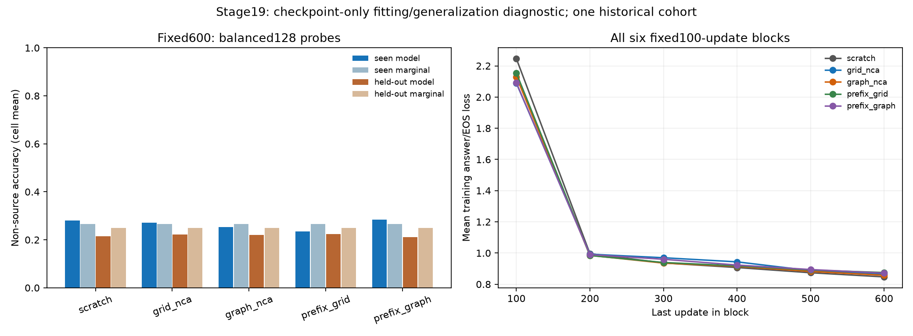

# Stage19: seen-probe fitting, held-out prediction and actual optimization

Completed local CPU checkpoint-only development diagnostic, 1 November 2026.
**No arm establishes the semantic target on its SEEN probe.** No fitting or additional update is performed. All original
stage18 outcomes, censoring, controls, costs and confirmation/OOD gates remain.

## Frozen question and evidence

Plan `959921b6a2852f0075ef2ca677c82af6dcf15134359c490beeb3360bd616359e` and the [frozen protocol](FROZEN_PROTOCOL.md) precede
new seen-probe prediction. Evaluate ALL five fixed update600 endpoints only.
The balanced128 seen cases are an outcome-blind salted graph-ID subset of the
original512,32 cases per task/size cell,64 graphs retaining both tasks. Every
selected example has9 or10 verified prior presentations. No selected earlier
checkpoint, extra fit, different objective, decoding constraint or head reset.

The SAME full development128 predictions from stage18 are copied byte-for-byte;
metrics/teacher counters are exact-value extractions from its original results.
They are not newly predicted or independently neurally replayed here.
Train/dev have identical task/size counts, not identical covariates; full edge/
source-degree/target-distance and graph counts are in plan.json. Tasks on the
same graph are correlated; no independent-case hypothesis test or CI is inferred.

Keep the original marginal predictor fitted on ALL512 training labels. It knows
the source but not adjacency/path computation. The same predictor is scored on
each probe's OWN cases, so its empirical rates and +10pp targets can differ:

| Probe | Task | Size | Baseline non-source accuracy | Required accuracy |
| --- | --- | --- | --- | --- |
| train | bfs_distances | 8 | 43.30% | 53.30% |
| train | bfs_distances | 10 | 40.62% | 50.62% |
| train | dijkstra_distances | 8 | 13.39% | 23.39% |
| train | dijkstra_distances | 10 | 9.38% | 19.38% |
| development | bfs_distances | 8 | 42.86% | 52.86% |
| development | bfs_distances | 10 | 44.79% | 54.79% |
| development | dijkstra_distances | 8 | 6.25% | 16.25% |
| development | dijkstra_distances | 10 | 5.56% | 15.56% |

Every cell must meet its own target together with >=95% pooled validity and
coverage1. The development baseline/targets remain EXACTLY stage18. The old80%
exact-vector calibration is separate and retained in each model's decision.
Invalid vectors count every semantic node wrong. No source-zero shortcut.

## Fixed endpoint: seen / held-out

| Arm | Exact vectors seen/dev | Non-source accuracy, cell mean seen/dev | Whole-node accuracy, example mean seen/dev | Semantic target seen/dev |
| --- | --- | --- | --- | --- |
| scratch | 0.00% / 0.00% | 28.00% / 21.43% | 28.65% / 20.59% | False / False |
| grid_nca | 0.00% / 0.00% | 27.10% / 22.17% | 26.43% / 21.66% | False / False |
| graph_nca | 0.00% / 0.00% | 25.27% / 22.01% | 25.49% / 20.78% | False / False |
| prefix_grid | 0.00% / 0.00% | 23.56% / 22.42% | 23.48% / 21.52% | False / False |
| prefix_graph | 0.00% / 0.00% | 28.44% / 21.18% | 28.12% / 20.61% | False / False |

Teacher-forced token scores supply gold earlier answers; digit-bearing tokens
can include punctuation. They are not free-generation semantic node accuracies.
The table below uses per-task/size-cell means, preserving the original scorer:

| Arm | Valid vectors seen/dev | Teacher digit accuracy seen/dev | Teacher other accuracy seen/dev | Teacher answer/EOS NLL seen/dev |
| --- | --- | --- | --- | --- |
| scratch | 100.00% / 100.00% | 37.66% / 28.09% | 100.00% / 99.93% | 0.7945 / 0.9440 |
| grid_nca | 100.00% / 100.00% | 34.86% / 26.46% | 100.00% / 99.84% | 0.8238 / 0.9335 |
| graph_nca | 100.00% / 100.00% | 36.02% / 25.47% | 100.00% / 99.92% | 0.8198 / 0.9396 |
| prefix_grid | 100.00% / 100.00% | 34.00% / 28.44% | 100.00% / 100.00% | 0.8376 / 0.9065 |
| prefix_graph | 100.00% / 100.00% | 34.08% / 25.02% | 100.00% / 100.00% | 0.8317 / 0.9239 |

[All40 cell rows](cells.csv) and [complete results](results.json) retain exact
and semantic counts, baseline advantages, source/one-hop/multi-hop errors,
signed/first-error details, coverage and both exact/semantic decisions. The
observed train/dev difference is descriptive, not a uniquely identified cause.
This selected seen probe is not an exhaustive measure of all512 training cases.

## Actual optimization and exposure

Import all600 updates per arm unchanged, not reconstructed from configured CI.
All sampled IDs/LR/input/target/padding/cumulative counts are checked against the
original frozen order and actual encodings. Fixed100-update blocks retain mean
loss, mean/min/max pre-clip norm, fraction above1, mean LR and actual tokens.
There is no best-block or best-checkpoint choice. [All30 blocks](trace_blocks.csv)
retain every predeclared block; full exact trace copies are under optimization.

| Arm | First50 update mean loss | Last50 update mean loss | Unique training cases | Presentations | Predeclared interpretation |
| --- | --- | --- | --- | --- | --- |
| scratch | 3.3198 | 0.8345 | 512 | 4800 | seen_probe_semantic_fitting_not_established |
| grid_nca | 3.0383 | 0.8539 | 512 | 4800 | seen_probe_semantic_fitting_not_established |
| graph_nca | 3.1146 | 0.8478 | 512 | 4800 | seen_probe_semantic_fitting_not_established |
| prefix_grid | 3.1606 | 0.8625 | 512 | 4800 | seen_probe_semantic_fitting_not_established |
| prefix_graph | 3.0595 | 0.8594 | 512 | 4800 | seen_probe_semantic_fitting_not_established |

The left panel separates model scores and each probe's own baseline; it is a
cell-mean non-source score, not exact match or micro-token accuracy. The right
panel connects six fixed block means, not an interpolated learning-speed target.
Loss mixes semantic/format/EOS targets and changing example exposures/LR. A lower
loss alone does not prove semantic fitting, convergence, a unique optimization
defect or that additional updates will repair generalization.

## Verification, costs and next decision

Separate same-code replay reloads all five endpoints and reproduces all640 NEW
seen generations/teacher scores, full600-step optimizer/count receipts, decisions
and trace summaries. Stage18's640 held-out predictions and35/4480 earlier replay
receipt are IMPORTED, not relabeled as new neural measurements. Public-only
reconstruction regenerates ID data/probe/order/baselines and independently parses
all1280 new/imported outputs, trace and cell counts without private weights,
cached raw data, tokenizer cache or network. It reaggregates teacher counters;
neural logits and optimizer weights require private replay.

[Provenance](PROVENANCE.json) binds36 exact evidence copies. Private checkpoint
weights, arrays and raw caches remain excluded; explicitly selected imported
synthetic-ID update traces contain identities/numeric records, not corpora or
weights. [Usage](../../FIT_AUDIT_V19_USAGE.md) documents execution/reproduction.
New scientific optimizer/PPT/language/GPU/OOD/official-test updates:ZERO.
New seen evaluation timers sum151.558s; preparation,
IO/replay/export command-wall costs are retained in the append-only logger.
Original costs remain in stage18 and are not zero-cost or newly timed here.
No paid/remote job, email, push or external publication occurs.

If seen readiness fails, preserve that unresolved fitting prerequisite alongside
held-out weakness; do not attribute everything to generalization alone. If seen
passes while development fails, preserve that gap without diagnosing a unique
mechanism. These are probe-specific development results, not eligibility to
relabel the old all-censored acceleration endpoint. A longer-budget experiment,
if chosen later, must keep data/architecture/objective/controls fixed and freeze
its schedule, budget, target/censoring and costs separately before fitting.

No automatic OOD/full-language run follows. Original categorical/random-rule
readiness, eligible starts, fresh independent paired cohorts, identical full
language/adaptation stages, all controls, ID-only selection and frozen OOD/
censoring/multiplicity/cost criteria remain under the separate confirmation
protocol. This diagnostic is not graph equivalence or acceleration evidence.
