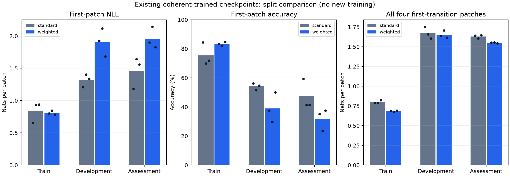

# Stage 9: first-transition fit versus held-out generalization

Completed 20 October 2026 on local CPU using existing checkpoints only.
**No new optimizer updates or model training occurred. Language remains gated.**
The [stage 8 negative result](../loss_weight_v8_run1/REVIEW.md) is unchanged.
This post-hoc development diagnostic was declared after inspecting stage 8
assessment outcomes, then frozen before new split scoring. It is not confirmation.
[Protocol](FROZEN_PROTOCOL.md), [plan](plan.json) and [receipt](plan_receipt.json):
`73eca0060bef35833a4579b3dc2c04f1353a093b90446621ba0dfb75f81aca9f`.

## Observed first-patch fit and generalization

Positive deltas below mean the weighted model is worse. The descriptive margin
is 0.01 nats, fixed before new scores. All three coherent seeds are retained.

| Seed | Train NLL delta | Development NLL delta | Assessment NLL delta | Frozen descriptive category |
| --- | ---: | ---: | ---: | --- |
| 131 | 0.147160 | 0.714747 | 0.716168 | fit_regression_on_train_and_assessment |
| 149 | -0.090349 | 0.711946 | 0.503166 | training_gain_with_assessment_reversal |
| 167 | -0.155300 | 0.349933 | 0.269025 | training_gain_with_assessment_reversal |

The result is mixed across seeds: two improve training first-patch NLL but worsen held-out NLL; one worsens on training data too. A single pooled mean would conceal this distinction. A generalization reversal is observed in seeds 149 and 167; held-out overfitting alone is insufficient to describe seed 131.

| Split | Objective | First-patch NLL | First-patch accuracy | Four-patch NLL | Four-patch accuracy | Marker NLL | Six-token NLL |
| --- | --- | ---: | ---: | ---: | ---: | ---: | ---: |
| train | standard | 0.843632 | 75.39% | 0.799360 | 78.42% | 0.028557 | 0.542426 |
| train | weighted | 0.810802 | 83.46% | 0.684029 | 87.48% | 0.030081 | 0.466046 |
| development | standard | 1.315831 | 54.17% | 1.672529 | 40.10% | 0.028557 | 1.124538 |
| development | weighted | 1.908040 | 39.06% | 1.652497 | 42.97% | 0.030074 | 1.111690 |
| assessment | standard | 1.461689 | 47.40% | 1.629741 | 42.90% | 0.028558 | 1.096013 |
| assessment | weighted | 1.957809 | 32.03% | 1.549562 | 46.48% | 0.030077 | 1.043067 |

These are three-seed means on coherent data for coherent-trained models.
Lower NLL is better. The original first patch sees only the full initial frame
and next start marker. The four-patch metric averages all patches of the first
transition; later patches condition on earlier TRUE patches. It is teacher-forced
prediction, not a free rollout, and supplies no later frame. Marker loss is
separated so formatting performance cannot masquerade as patch competence.

| Objective | Mean development minus train first NLL | Mean assessment minus train first NLL |
| --- | ---: | ---: |
| standard | 0.472199 | 0.618058 |
| weighted | 1.097238 | 1.147007 |

Positive gaps indicate worse held-out likelihood. Training examples here are
the original sampled cache, not new examples. The 512/64/128 initial conditions
retain their original joint-phase-disjoint split. Phase disjointness prevents
the defined exact orbit leakage; it does not guarantee learned rule generalization.

Bars are three-seed means; dots are individual seeds. These compare splits at
fixed final endpoints and are not convergence curves or acceleration estimates.

## The weighted transition and its first patch are different findings

The weighted model has lower whole-first-transition four-patch NLL on BOTH
train and assessment in all three coherent seeds. Its four-patch accuracy also
improves in each seed on these two splits. This coexists with worse held-out
FIRST-patch NLL and accuracy in every coherent seed. Aggregate first-transition
prediction therefore hides the queried first-patch failure, just as full-trajectory
readiness failed to detect it in stage 8. Lower whole-transition training loss
does not establish a general inability to fit the weighted task; nor does it
prove why the initial spatial prediction generalizes poorly.

The sixfold treatment weighted six targets, including markers, rather than
isolating the first patch. These results show different predictive behavior
across that aggregate objective. They do not identify gradient interference,
capacity, a particular shortcut or a unique internal circuit. Both standard and
weighted models have nonzero training errors and generalization gaps.

## Shuffled controls and complete scoring

Shuffle-trained controls on their actual prefix-shuffled data:

| Split | Objective | First-patch NLL | First-patch accuracy | Four-patch NLL | Four-patch accuracy |
| --- | --- | ---: | ---: | ---: | ---: |
| train | standard | 1.925605 | 31.84% | 1.911804 | 31.61% |
| train | weighted | 1.515199 | 57.23% | 1.488965 | 59.68% |
| development | standard | 2.265717 | 21.88% | 2.226074 | 20.70% |
| development | weighted | 2.366002 | 18.23% | 2.298578 | 18.88% |
| assessment | standard | 2.286644 | 17.97% | 2.220843 | 18.75% |
| assessment | weighted | 2.375303 | 14.32% | 2.322507 | 19.08% |

Both model arms are additionally scored on the other data version, and initial
models remain. All 15 model conditions x three splits x two data versions are
retained: 90 cells and 21,120 scoring exposures.
These are repeated measurements of the same 704 cached initial conditions and
three initialization seeds, not independent rule/data cohorts or 21,120 independent
samples. No confidence interval or significance claim is inferred from query rows.
See [all cells](cells.csv), [group means](group_means.csv),
[paired categories](paired_comparisons.csv), [gaps](generalization_gaps.csv),
[per-query results](results.json) and [summary](summary.json).

## Integrity and next decision

Every coherent assessment first-patch mean, accuracy and per-query vector agrees
EXACTLY with the corresponding stage 8 record (all 15 checkpoint conditions).
The longer causal prefix gives a maximum first-patch loss difference of
4.76837158e-07 nats, below the frozen 1e-5 tolerance,
with identical argmax correctness. Short-prefix scores remain authoritative.
Reloading all 15 initial/final files reproduces every one of the 90 cells and
all descriptive categories exactly in a separate invocation using the same
scorers. This is checkpoint replay, not independently implemented loss code or
new training. Seven source/public copies have [SHA provenance](PROVENANCE.json);
[verification](verification.json) binds results. Raw arrays, weights, optimizer
states and original evidence remain preserved privately.

Eight new scoring/category tests pass; the complete local suite passes 122 tests,
including two subsequent starter-snapshot integrity regressions.
Tests cover fixed positions and patch/marker normalization, actual causal prefixes,
future-frame exclusion, short/long agreement, invalid inputs, all controls,
comparison signs/margins and paired gap arithmetic. No remote CI execution is
claimed. This run used CPU inference; no GPU speed or training-cost recovery was
measured.

The next candidate development treatment is **initial-condition diversity alone**:
hold the objective definitions, model, rule, representation and update/token
budget fixed while varying training-phase coverage, retaining standard/weighted
and both matched shuffled controls. Declare it separately before fitting and
keep first-patch, whole-transition and generalization measurements distinct.
This candidate responds to the observed fit/generalization gaps; this diagnostic
does not prove it will help. Do not combine it with a new weighting factor,
topology or serializer and attribute any result to data diversity. No such
treatment has been trained or configured by this diagnostic.

Fresh joint-phase-disjoint data are required for later confirmation. Original
random-rule checkpoints still fail stage 5 readiness. Any return to a language
suite requires a separately frozen eligible synthetic configuration, fresh paired
cohorts and an identical full language stage. No remote/paid training, official
language-test access, model update, publication or historical-evidence rewrite
occurred here.
