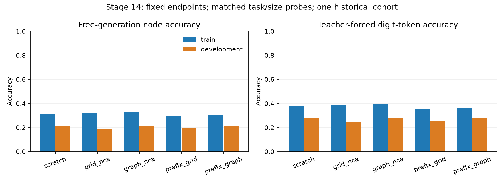

# Stage 14: matched training/development error audit

Completed local CPU checkpoint-only diagnostic, 31 October 2026.

**Every arm fails competence on the SEEN training probe as well as development. Held-out generalization alone cannot account for all observed failure.** This establishes a limitation on the selected training examples;
it does not identify a unique optimization, capacity, data, representation or
rollout mechanism. No new fitting is performed, and OOD remains gated.

## Frozen scope and observations

Plan: `190ab24f24655072f8ebfe9f309d61135920aab57dd7c7611628db6fef57e393`. The [frozen protocol](FROZEN_PROTOCOL.md)
precedes new predictions. Retain ALL five stage 13 fixed final checkpoints at
600 adaptation updates. No best endpoint or arm is selected. The stage 13
failed criterion, historical language procedure, stronger synthetic-readiness
failure and earlier controls/results remain unchanged.

Both probes have 128 examples /64 base graphs: 32 per task/size cell for BFS
and Dijkstra at 8 and 10 nodes, native cyclic ER graphs. Training selection is
by frozen salted base-ID hash, including both tasks per graph; it does not
depend on labels or outputs. Each selected training example was actually used
9–10 times in stage 13; development examples were
never in its optimizer batches. These are a quarter of the training cache, not
an exhaustive fitting census. Development was already inspected in stage 13;
no untouched-confirmation claim applies. No independent graph-cohort CI/p-value.

Each table entry is TRAIN / DEVELOPMENT. NLL and digit accuracy are macro means
of the four matched task/size cells; NLL is token-weighted within each cell.
The earlier eight-node-only training NLL composition mismatch is avoided.

| Arm | Exact vectors | Generated node accuracy | Teacher-forced digit tokens | Answer/EOS NLL |
| --- | ---: | ---: | ---: | ---: |
| scratch | 0.00% / 0.00% | 31.39% / 21.60% | 37.50% / 27.87% | 0.8172 / 0.9764 |
| grid_nca | 0.00% / 0.00% | 32.34% / 18.95% | 38.42% / 24.36% | 0.8154 / 0.9912 |
| graph_nca | 0.00% / 0.00% | 32.89% / 21.07% | 39.61% / 28.09% | 0.7951 / 0.9983 |
| prefix_grid | 0.00% / 0.00% | 29.55% / 19.59% | 35.06% / 25.47% | 0.8370 / 0.9660 |
| prefix_graph | 0.00% / 0.00% | 30.59% / 21.37% | 36.29% / 27.52% | 0.8199 / 0.9713 |

Teacher-forced OTHER-token accuracy is
100.00%–100.00%
on training and
99.92%–100.00%
on development. The digit-bearing subset remains
35.06%–39.61%
on training and
24.36%–28.09%
on development. This separates easy conditional formatting from weak conditional
value-token prediction. It does not identify a unique reason for that weakness.

Gold earlier answer tokens condition teacher-forced predictions; prompt-only
greedy generation receives no gold answer. Digit-bearing GPT-2 tokens can span
signs or punctuation; their accuracy is not semantic integer accuracy. NLL and
teacher-forced accuracy cannot replace full generated-vector correctness.
The [40-cell CSV](matched_cells.csv) and complete per-case result JSON retain
format validity, coverage, signed errors, first wrong positions, all token
counts and per-task/size differences. Invalid vectors contribute zero node
correctness and remain in every unconditional source/hop denominator.

| Arm | Probe | Source node | One-hop nodes | Multi-hop nodes |
| --- | --- | ---: | ---: | ---: |
| scratch | train | 26.56% | 36.61% | 28.88% |
| scratch | development | 10.94% | 22.16% | 23.11% |
| grid_nca | train | 26.56% | 40.98% | 28.42% |
| grid_nca | development | 9.38% | 21.91% | 19.03% |
| graph_nca | train | 46.09% | 33.06% | 29.79% |
| graph_nca | development | 13.28% | 19.07% | 23.90% |
| prefix_grid | train | 25.00% | 35.25% | 27.05% |
| prefix_grid | development | 10.16% | 19.59% | 21.54% |
| prefix_graph | train | 34.38% | 41.80% | 22.64% |
| prefix_graph | development | 14.84% | 24.74% | 20.28% |

Hop categories use unweighted connectivity for BOTH tasks, including weighted
Dijkstra. Rates above use all relevant node counts, including malformed outputs;
they are descriptive micro rates within a probe. Task/size cells remain in the
CSV. Matching does not equalize degree, distances or token lengths: descriptive
covariates for each cell are preserved in `plan.json`. Across-split differences
are unpaired and do not prove a causal generalization mechanism.

Frozen interpretation flags (80% exact in every cell, 95% pooled format and
complete coverage are required for probe competence):

- scratch: `training_probe_competence_not_established`; exact train-minus-dev 0.00%.
- grid_nca: `training_probe_competence_not_established`; exact train-minus-dev 0.00%.
- graph_nca: `training_probe_competence_not_established`; exact train-minus-dev 0.00%.
- prefix_grid: `training_probe_competence_not_established`; exact train-minus-dev 0.00%.
- prefix_graph: `training_probe_competence_not_established`; exact train-minus-dev 0.00%.

## Verification and provenance

Independent Floyd-Warshall checks every selected label; original stage 12
structural/cut split exclusion receipts and stage 13 actual exposure identities
remain intact. Prior integrity verification can rehash old assessment bytes;
only ID probes enter new prediction/scoring. Original development generations
reproduce stage 13 final token IDs/text/stops exactly for all five models.

A separate process reopens five checkpoints and exactly reproduces all
1,280 new train/development generations, teacher-forced
scores, node errors and fixed interpretation flags. Model tensors and checkpoint
hashes stay identical before/after inference, and retained optimizer steps
remain 600. This is same-code replay, not independently implemented neural
inference or another fitting run. New scientific optimizer updates: **zero**.

[Provenance](PROVENANCE.json) binds 22 exact evidence copies. Private
weights, datasets, caches and correspondence remain excluded. The public
`scripts/reproduce_id_audit_v14.py` regenerates exact matched probe bytes and
rescores all 1280 exported generated answers without private weights, data,
tokenizer cache or network. It cannot reproduce neural/teacher-forced scores
without weights. See the [usage guide](../../ID_AUDIT_V14_USAGE.md).

Summed new per-model inference/scoring timers: 324.507s,
including model construction/load, both generation probes and teacher-forced
measurements, excluding initial provenance preparation and separate replay.
Full command wall times remain logged. Original PPT/language/adaptation costs
are historical evidence, not zero or newly timed. No GPU/learning-speed ratio,
graph equivalence/no-effect, causal mechanism or cost recovery is established.

## Next decision

Every arm fails competence on the SEEN training probe as well as development. Held-out generalization alone cannot account for all observed failure.

Keep OOD and further full language suites gated. The next economical proposal
is a separately frozen small-cache overfit positive control: keep architecture,
tokenizer, output format, objective and update budget fixed, and change training
cache size alone. Retain the original cache reference and all five arms from
their same pre-adaptation starts. This can test whether the procedure can fit a
small declared set reliably before attempting broader generalization; it does
not promise that reducing or increasing data fixes the failure. It is a proposal,
not a new fit or an extension of stage 13. Do not relax its target, drop a control,
select a checkpoint or change multiple factors together. This audit identifies
seen-example competence as an unresolved prerequisite, not a unique cause.

The categorical/random-rule readiness bridge and eligible synthetic starts
remain separately necessary before a fresh graph-transfer study. Retain scratch,
grid and both prefix controls, identical language/adaptation stages, fresh paired
cohorts, ID-only selection, frozen OOD criteria and total costs. No remote/paid
job, official language test, email, push or external publication occurs here.
