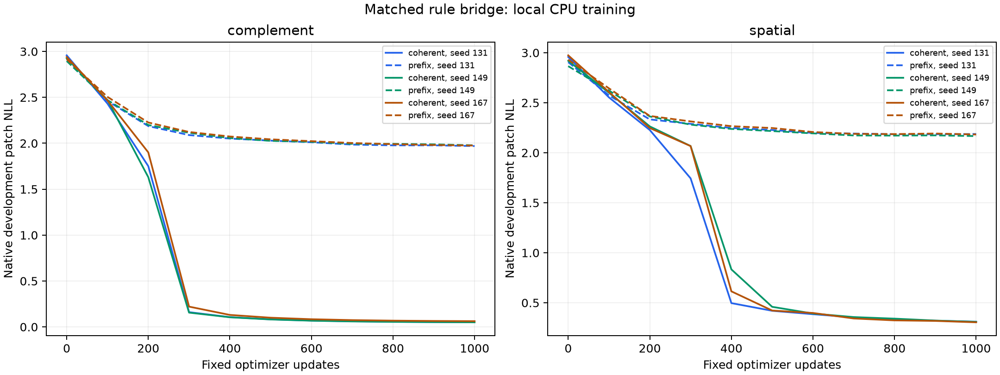

# Stage 7: matched spatial-interaction bridge

Completed 20 October 2026 on CPU. Readiness: **True**;
spatial local-table qualification: **True**;
combined bridge: **True**. Language training remains disabled.
Separately frozen stricter first-transition diagnostic:
**True**.
All twelve models finished the fixed 1000-update budget. The [protocol](FROZEN_PROTOCOL.md),
[plan](plan.json) and [receipt](plan_receipt.json) were frozen before training:
`869690ac3805b2b015d4d918d7e3ca742358c7185b983cdcf41ae32476942251`.

## One spatial treatment and a new matched reference

The reference flips every binary cell: x' = 1 XOR x. Treatment adds a neighbor
parity term: x' = 1 XOR x XOR left XOR right, with periodic horizontal boundaries.
It creates a genuine dependence across 2x2 patch boundaries. Both maps are
bijective involutions on this 4x4 lattice; neither collapses after a few steps.
Exhaustive tests cover all 65,536 initial states. The added interaction changes
phase-equivalence classes, so BOTH rules use a new shared split excluding their
complete joint orbits. Do not compare historical stage 6 and stage 7 as a
controlled treatment contrast. Its earlier [review](../trainability_v6_run1/REVIEW.md)
remains unchanged evidence.

Inside this stage the initial grids, 512/64/128 split sizes, actual starting
weights, model/data seeds and minibatch indices match across all four arms in
each seed. Joint-orbit classes never cross splits under either rule. Alphabet,
4x4 grid, eight frames, context 47, 2x2 serializer, full six-layer/192-wide/four-head
backbone, tied head, Adam/LR schedule, accumulation and 1000-update endpoint
retain stage 6 settings. Numerical updates and scores import unchanged v4/v5
code. The rule alone differs between the new reference and spatial treatments.
Three seeds share one split and two fixed rules; they are initialization
replicates, not independent random-rule/data/topology cohorts.

## Frozen assessment and results

No assessment likelihoods were computed until all twelve full-budget models
finished. Final checkpoints are used without selection or early stopping.
Each cell scores 128 held-out initial conditions x 28 patches = 3584 targets.
Each rule/seed has initial, coherent-trained and shuffle-trained checkpoints
scored on coherent and matched shuffled data: 36 cells total. Initial frames,
markers and supervised target histograms match within each shuffle pair.

Both inherited readiness advantages must be >=0.01 nats per patch. A separate,
prospectively declared spatial qualification requires all three spatial models
to beat a train-only add-one p(next patch | previous SAME patch) table by >=0.01.
This table lacks neighboring-patch information. That qualification is reported
separately; the reference table is not required to lose to its transformer.

| Rule | Seed | Coherent NLL | Frequency advantage | Ordering advantage | Own-patch table advantage | Both readiness checks |
| --- | ---: | ---: | ---: | ---: | ---: | --- |
| complement | 131 | 0.051448 | 2.301134 | 4.627438 | -0.034829 | Pass |
| complement | 149 | 0.050904 | 2.301679 | 4.679540 | -0.034285 | Pass |
| complement | 167 | 0.062718 | 2.289864 | 4.405063 | -0.046099 | Pass |
| spatial | 131 | 0.295222 | 1.811754 | 4.036635 | 2.518804 | Pass |
| spatial | 149 | 0.303057 | 1.803919 | 3.930736 | 2.510969 | Pass |
| spatial | 167 | 0.311129 | 1.795847 | 3.640951 | 2.502897 | Pass |

Higher advantages are better. The local-table comparison is a finite learned
baseline, not a Bayes-optimal bound over all predictors using local information.
It does not prove an attention mechanism or the precise circuit learned.

| Rule | Mean coherent NLL | Mean patch accuracy | Frequency NLL | Own-patch table NLL | Shuffle-trained readiness passes |
| --- | ---: | ---: | ---: | ---: | ---: |
| complement | 0.055023 | 100.00% | 2.352583 | 0.016619 | 3/3 |
| spatial | 0.303136 | 91.84% | 2.106976 | 2.814026 | 0/3 |

Shuffle-trained checkpoint gates are descriptive controls, not additional
admission conditions. Their ordering gaps and differences from coherent-trained
gaps remain in [full results](results.json). Readiness is predictive competence,
not a causal proof that coherent pre-pre-training produces language gains.
Loss levels belong to different target distributions and are not a language
performance comparison or evidence that the spatial task trains faster.

The causal frequency predictor is fitted only on each rule's training data;
its joint score is invariant under the matched shuffle. The positive control
uses each known rule and the actually observed previous FULL frame, assigning
.99 to its predicted next patch and .01/15 to other patch tokens. It is an
oracle measurement control, not a learned model. It replaces the own-patch
table control for both new treatments because that table cannot represent the
spatial rule. This evaluation change does not alter training or readiness margins.

| Oracle rule | Coherent NLL | Matched shuffled NLL | Both readiness checks |
| --- | ---: | ---: | --- |
| complement | 0.010050 | 6.068177 | Pass |
| spatial | 0.010050 | 6.343268 | Pass |

Both frequency-only negative controls correctly fail zero self/ordering
advantages. All per-initial-condition losses/accuracies/counts and the
[36-cell CSV](assessment_cells.csv) are retained. Source-run copies have
[SHA provenance](PROVENANCE.json); [summary](summary.json) and
[verification](verification.json) bind the result.

## Verification, scope and next step

All 36 cells and decisions replay exactly after reopening the three initial
and twelve final checkpoint files, including final optimizer counts. This is
a separate replay using the same scorer, not independent loss code or a training
rerun. Frozen identities cover sources, arrays, split classes, initial states,
summaries and final models. Private weights, optimizer moments and raw arrays
remain preserved outside publication. Ten new structural/integrity regressions
and a retained tiny four-arm execution fixture are separate from this scientific
run. The full local software suite passes 104 tests; configured CI is not a
completed remote CI run.

Recorded per-model CPU stage timers sum to 13.464
minutes, including setup, development evaluation and checkpoint writing. Total
updates/input tokens: 12,000/2,256,000.
Assessment/replay/export are additional work. These are local CPU timings,
not GPU speedups or cloud billing measurements.

## Separately frozen first transition and neighbor intervention

Both rules have period two, so later-frame own-patch recall could beat a
one-frame local table. The primary qualification alone does not rule out this
shortcut. During training, before any primary assessment or final-checkpoint
assessment was inspected, a separate [supplementary plan](first_transition/plan.json)
and [protocol](first_transition/FROZEN_PROTOCOL.md) were frozen. This diagnostic
was not part of the original pre-training plan and does not change its status.

It scores only the FIRST patch of the FIRST transition, conditioned on the full
initial frame and next start marker. No repeated prior frame or new-frame patch
is available. All 128 original queries remain. Flip initial cell (0,3), outside
the target patch but adjacent through the periodic boundary: its spatial target
patch must flip bit zero; its complement target stays unchanged. A shared mask
excludes changed initial states whose joint orbit occurs in train/development,
leaving 122 eligible pairs, fixed before scoring. No primary
row or seed is dropped. Compare original first-patch NLL to BOTH a train-fitted
first-patch conditional table and uniform log(16), with a separate 0.01-nat
criterion. The stricter status above requires all three spatial coherent models
to pass. Counterfactual accuracy is reported without a post-hoc acceptance cutoff.

| Spatial seed | First-patch NLL | Original accuracy | Changed-query accuracy | Both correct in eligible pair | Stricter check |
| --- | ---: | ---: | ---: | ---: | --- |
| 131 | 1.182625 | 59.38% | 54.10% | 33.61% | Pass |
| 149 | 1.642562 | 41.41% | 31.97% | 12.30% | Pass |
| 167 | 1.559881 | 41.41% | 40.16% | 13.93% | Pass |

Mean original first-patch accuracy is 47.40%;
mean eligible intervention accuracy is 42.08%.
All 18 initial/coherent/shuffle first-transition cells and their per-query values
are retained in [supplementary results](first_transition/results.json) and replay
exactly from the same saved model files. These predictions address this queried
neighbor perturbation, not unseen-rule induction or a unique internal circuit.
The new diagnostic preserves all primary and historical outcomes.

The full-trajectory spatial accuracy (91.84%) therefore overstates performance
at the first spatial prediction (47.40%). Only 19.95% of eligible intervention
pairs have BOTH target patches predicted correctly. This is partial known-rule
learning, not reliable execution across all queried initial conditions.

For context, means across the same three seeds for both trained controls:

| Rule | Training data | First-patch NLL | Original accuracy | Changed accuracy | Stricter first-transition passes |
| --- | --- | ---: | ---: | ---: | ---: |
| complement | coherent | 0.057790 | 100.00% | 100.00% | 3/3 |
| complement | prefix | 1.686413 | 44.53% | 38.25% | 0/3 |
| spatial | coherent | 1.461689 | 47.40% | 42.08% | 3/3 |
| spatial | prefix | 2.392352 | 13.54% | 11.48% | 3/3 |

These control comparisons are descriptive. They do not redefine the primary
decision or make the supplementary diagnostic a test of language transfer.
The spatial shuffle-trained models also pass the small supplementary NLL margin
in all three seeds, with much weaker accuracy. That margin alone is not a causal
test of coherent-training benefit.

The bridge clears both readiness and the separately declared local-table qualification. Review the first-transition/intervention errors before declaring the next single change; a residual first-transition bottleneck should be addressed before increasing rule diversity. Measure held-out-rule learning before returning to a language suite.

The concrete next development proposal is a matched first-transition
loss-weighting ablation: keep this spatial rule, model, data and total
update/token budget fixed, and change only the relative weight assigned to
the first transition. Freeze its protocol before fitting and retain standard-loss
and shuffled controls. This is a proposed new study, not a retuning or extra
run performed here.

These inspected initial conditions are development data. Any later confirmation
needs fresh joint-phase-disjoint data.

This tests one fixed interacting rule on a deliberately small binary task.
It does not establish unseen-rule generalization, GraphNCA acceleration or cost
recovery. Original random-rule checkpoints retain failed stage 5 readiness.
No language-training command, graph rewiring, serializer change, paid job,
remote GPU run or official-language-test access occurred. Any later transfer
study still needs its own synthetic readiness, fresh paired cohorts and an
identical full language stage.
