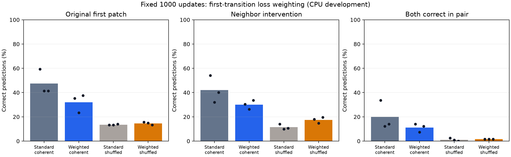

# Stage 8: first-transition loss-weighting ablation

Completed 20 October 2026 on local CPU. Frozen all-seed primary improvement:
**False**. Language training remains disabled.
Six new weighted models completed 1000 updates each, compared with six preserved,
verified standard-loss spatial controls from [stage 7](../interaction_v7_run1/REVIEW.md).
The [protocol](FROZEN_PROTOCOL.md), [plan](plan.json) and [receipt](plan_receipt.json)
were frozen before new scientific fitting. Plan SHA-256:
`d8d69d609cf9de8b1bf683397eebdc8468ce5b82513f653d142a4e2481a21abf`.

## What changed and what remained matched

Only the supervised training objective changes: all six targets of the first
transition have weight 6; the remaining 36 valid targets have weight 1; masked
initial-context targets have weight 0. Divide summed weighted cross-entropy by
the weight sum (72 per sequence). The first transition contributes 50% of the
objective instead of 1/7. Patch/marker total weight remains 2/3 versus 1/3.
This weights the entire first transition, not solely the queried first patch.
Evaluation always uses the original unweighted predictive likelihood.

The rule remains x' = 1 XOR x XOR left XOR right on a periodic 4x4 binary grid.
The same cached train/development/assessment arrays and query mask are copied
byte-for-byte. Every seed reuses its actual initial weights and minibatch order.
Six layers, width 192, four heads, 47-token context, 2x2 patches, eight frames,
512/64/128 split, Adam, LR schedule, accumulation, 1000 updates, 188,000 input
tokens and 168,000 supervised targets per model remain matched. No additional
examples or optimizer updates are introduced. Weighting adds pointwise arithmetic;
this is equal update/token exposure, not an assertion of identical FLOPs or time.

The standard controls are imported historical CPU runs, not freshly retrained
controls. Their complete saved parameters, input/source identities, optimizer
counts, initial states and original assessments are verified and replayed.
Their metrics and hashes remain in the stage 7 evidence; the six selected
identities are additionally bound in this [plan](plan.json). New weighted models
are trained from initialization, never continued from a standard endpoint.
Coherent and matched prefix-shuffled training arms are retained for all seeds.

## Frozen decision and full results

For EACH coherent seed, require standard NLL minus weighted NLL >=0.01 nats on
both the 128 original first-patch queries and 122 eligible neighbor interventions.
Also retain both inherited full-trajectory frequency and ordering readiness
advantages >=0.01 nats. All three must pass; final update 1000 is the only endpoint.
The first query conditions on the initial frame and next start marker, before
any repeated frame or next-frame patch. The intervention flips initial cell (0,3)
outside the target patch; the correct spatial output flips bit zero. Six changed
joint phases overlapping training/development remain excluded under the original
mask; no original query or seed is dropped. All data are inspected development
data. These seeds share one split/rule and are initialization replicates.

| Seed | Original NLL improvement | Intervention NLL improvement | Weighted trajectory readiness | Both first-patch improvements |
| --- | ---: | ---: | --- | --- |
| 131 | -0.716168 | -0.682965 | Pass | Fail |
| 149 | -0.503166 | -0.288322 | Pass | Fail |
| 167 | -0.269025 | -0.222588 | Pass | Fail |

Positive improvements favor weighting. The primary concerns predictive NLL;
accuracy and paired correctness have no newly invented admission threshold.

| Objective | Training data | Original NLL | Original accuracy | Changed NLL | Changed accuracy | Both correct | Full NLL | Full accuracy | Trajectory readiness |
| --- | --- | ---: | ---: | ---: | ---: | ---: | ---: | ---: | ---: |
| initial | initial | 2.953502 | 2.60% | 2.975016 | 2.46% | 0.00% | 2.934901 | 5.49% | 0/3 |
| standard | coherent | 1.461689 | 47.40% | 1.608771 | 42.08% | 19.95% | 0.303136 | 91.84% | 3/3 |
| standard | prefix | 2.392352 | 13.54% | 2.366482 | 11.48% | 1.09% | 2.114530 | 19.75% | 0/3 |
| weighted | coherent | 1.957809 | 32.03% | 2.006729 | 30.05% | 11.20% | 1.347235 | 50.86% | 3/3 |
| weighted | prefix | 2.411193 | 14.58% | 2.407887 | 17.49% | 1.64% | 2.154709 | 21.50% | 0/3 |

Means span three seeds. Coherent first-patch accuracy changes from
**47.40% to 32.03%**;
intervention accuracy from **42.08% to 30.05%**;
paired-both correctness from **19.95% to 11.20%**.
Full-trajectory accuracy changes from 91.84%
to 50.86%; preserve this whole-trajectory change alongside the
first-transition result. Initial-model scores, all control outcomes and target
counts remain in [full results](results.json), the [30-cell CSV](full_cells.csv)
and [15-case first-transition CSV](first_transition_cells.csv).

Bars show means; dots show the three initialization seeds.

## Shuffled controls and interpretation

| Seed | Shuffled-model original NLL improvement | Coherent gain minus shuffled gain |
| --- | ---: | ---: |
| 131 | 0.020799 | -0.736967 |
| 149 | -0.024030 | -0.479136 |
| 167 | -0.053292 | -0.215733 |

These differences are descriptive. They are not an added primary criterion,
confidence interval or causal proof of a unique learned mechanism. A model
can improve likelihood without complete rule execution. Matching this single
neighbor perturbation does not establish every spatial dependency, unseen-rule
generalization or language transfer. Period-two recall can still help later
trajectory predictions; first-transition scoring limits that particular shortcut.

## Verification, costs and next decision

All 30 full-trajectory cases and 15 original/intervention checkpoint cases replay
exactly in a separate invocation after reloading saved checkpoints. Each full
case scores 128 initial conditions x 28 patch targets. Standard scores agree
exactly with their original stage 7 assessments. Replay uses the same frozen
scorers; it is not independent loss code or retraining from scratch.
[Verification](verification.json), [summary](summary.json) and the 21-copy
[provenance manifest](PROVENANCE.json) retain the compact evidence. Raw arrays,
weights and optimizer states remain private and preserved.

Eight new objective/matching tests and a retained two-update execution fixture
are separate from scientific evidence. The complete local software suite passes
112 tests. The fixture uses shorter weighted training against historical controls
and supports execution only. It is not included in the scientific comparison.
The factor-one regression reproduces the original training update exactly,
including all parameter values and sampled index order.

New weighted training: 6,000 updates,
1,128,000 input tokens; recorded stage timers sum to
7.481 CPU minutes. Imported control stage timers
sum to 6.729 historical CPU minutes.
The comparison accounts for twelve model budgets (12,000 updates / 2,256,000
input tokens), with six newly fitted and six reused. Assessment, replay, tests
and export add work. Concurrent local checks and different invocation conditions
prevent interpreting these stage timers as a controlled throughput comparison.
No GPU acceleration, reduced-token convergence or cost recovery is measured here.

The declared all-seed objective comparison fails. Every coherent seed has worse original AND intervention NLL; the trajectory readiness check alone misses this regression. Preserve the sixfold factor and negative endpoint. The next development diagnostic should compare first-transition train/development/assessment errors using these existing checkpoints, before choosing another treatment. This would separate a failure to fit the weighted prediction from a held-out generalization gap; it would not identify a unique cause. That additional diagnostic has not been executed here. Do not extend training, select a checkpoint, relax the margins or discard a seed in this study.

The next bridge to interacting categorical/random rules must separately clear
synthetic readiness. Original random-rule checkpoints retain failed stage 5
readiness. Any language-transfer study needs a separately frozen configuration,
fresh paired cohorts and an identical full language stage. This study changes no
topology, serializer or budget. No remote/paid training, official language test,
language stage or publication was launched.
