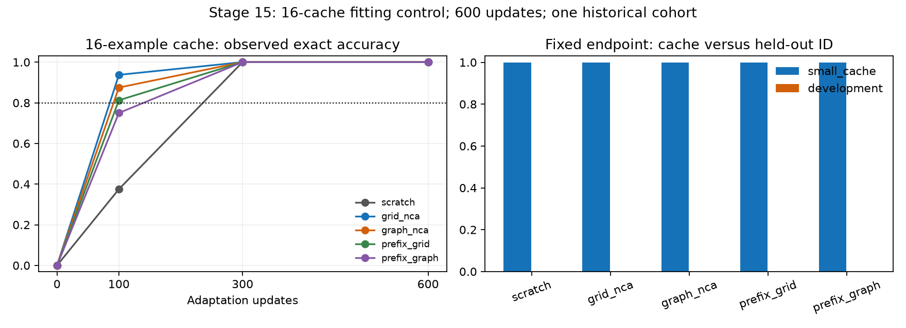

# Stage 15: small-cache overfit control

Completed local CPU development study, 31 October 2026.

**The small-cache fitting positive control PASSES for all five arms.** This tests fitting of a declared cache, not unseen-graph algorithm
execution or GraphNCA acceleration. The original random-rule readiness failure,
categorical bridge and stage 13 negative full-ID endpoint remain intact. OOD is
gated regardless of this positive-control result.

## Frozen one-factor treatment and reference

Plan: `2efa24ef3342b417e796078bdca5d1743e202bdee6e6bac532d51bd54cf05c65`. The [frozen protocol](FROZEN_PROTOCOL.md)
precedes new fits. Only training cache size changes, 512 to 16 examples: four
graphs per size (8,10), both BFS/Dijkstra tasks, four examples per task/size cell.
Selection uses the SAME outcome-blind salt/ranking as stage 14, nested inside its
128-example training probe and the original 512 cache. These are inspected
development data, not fresh confirmation or independent graph cohorts.

ALL five arms restart from their original complete stage 13 step-0 language
models, including the learned tied heads, with fresh optimizer state. No model
continues its old step-600 fit. Architecture, GPT-2 vocabulary/context, prompt/
answer/EOS format, answer-only loss/masks, full-model fp32 CPU AdamW, clipping,
warmup/cosine LR, batch 8, seed and 600-update budget are unchanged. Numerical
update-equivalence and reference-subset tests pass before the freeze.

The verified historical 512-cache fits supply an IMPORTED reference. Their final
stage 14 per-case evidence is reaggregated onto the SAME selected 16 examples and
the SAME full 128 development examples, preserving raw reference outputs and
teacher counters. No reference fit or GPU measurement is rerun or relabeled.

| Per arm | Small-cache treatment | Historical reference |
| --- | ---: | ---: |
| Distinct training examples | 16 | 512 |
| Optimizer updates | 600 | 600 |
| Example presentations | 4800 | 4800 |
| Presentations per selected example | 300 | 9–10 |
| Unpadded input tokens | 571,200 | 562,855 |
| Supervised answer/EOS targets | 96,000 | 96,016 |
| Padded input positions | 708,488 | 691,560 |

Cache diversity/content/repetition and lengths are coupled consequences of this
cache treatment; sample means/identities are in plan.json. Fixed updates and
presentations do NOT imply identical tokens, FLOPs, time or isolated repetition
causality. Same-cache evaluation controls the evaluation examples, not those
training-distribution consequences.

## Fixed endpoint results

| Arm | Small-cache fit, same 16 | 512-reference, same 16 | Small-cache model, ID-dev128 | 512-reference, ID-dev128 | Fit criterion |
| --- | ---: | ---: | ---: | ---: | --- |
| scratch | 100.00% | 0.00% | 0.00% | 0.00% | pass |
| grid_nca | 100.00% | 0.00% | 0.00% | 0.00% | pass |
| graph_nca | 100.00% | 0.00% | 0.00% | 0.00% | pass |
| prefix_grid | 100.00% | 0.00% | 0.00% | 0.00% | pass |
| prefix_graph | 100.00% | 0.00% | 0.00% | 0.00% | pass |

Every small-cache model still fails the original full-ID competence criterion. Exact-vector scores alone do not describe all regressions or gains;
format validity and node/token scores below retain the broader held-out behavior.

The frozen criterion requires EVERY arm to reach >=80% exact in EVERY four-
example cache cell, >=95% pooled valid vectors and complete coverage. Thus each
cell needs 4/4. Final per-cell scores, all malformed completions and teacher
counts remain in the [140-cell CSV](cells.csv) and complete results JSON. New
development is measured only at fixed update 600 and never selects an endpoint.
Its original full-ID criterion is separately reported, not replaced by cache fit.

First recorded pooled 80% CACHE crossing, without interpolation:

| Arm | Update |
| --- | --- |
| scratch | 300 |
| grid_nca | 100 |
| graph_nca | 100 |
| prefix_grid | 100 |
| prefix_graph | 300 |

Lines connect only the four recorded cache evaluations. Coincident curves can
overlap. The pooled crossing line is not the stricter final per-cell decision;
no independent-cohort confidence interval or learning-speed ratio is inferred.

| Arm | Valid vectors, cache /dev | Teacher-forced digit accuracy, cache /dev | Generated node accuracy, cache /dev |
| --- | ---: | ---: | ---: |
| scratch | 100.00% / 66.41% | 100.00% / 20.18% | 100.00% / 12.03% |
| grid_nca | 100.00% / 53.12% | 100.00% / 20.43% | 100.00% / 9.65% |
| graph_nca | 100.00% / 51.56% | 100.00% / 19.47% | 100.00% / 8.61% |
| prefix_grid | 100.00% / 62.50% | 100.00% / 20.59% | 100.00% / 12.34% |
| prefix_graph | 100.00% / 53.91% | 100.00% / 19.59% | 100.00% / 9.18% |

On the identical held-out data, SMALL16 / HISTORICAL512 continuous metrics are:

| Arm | Development valid vectors | Development node accuracy | Development answer/EOS NLL |
| --- | ---: | ---: | ---: |
| scratch | 66.41% / 99.22% | 12.03% / 21.60% | 2.5892 / 0.9764 |
| grid_nca | 53.12% / 100.00% | 9.65% / 18.95% | 2.6205 / 0.9912 |
| graph_nca | 51.56% / 100.00% | 8.61% / 21.07% | 2.8112 / 0.9983 |
| prefix_grid | 62.50% / 98.44% | 12.34% / 19.59% | 2.6779 / 0.9660 |
| prefix_graph | 53.91% / 98.44% | 9.18% / 21.37% | 2.7199 / 0.9713 |

These retain endpoint regressions/gains even when both exact-vector scores are
zero. They are single-cohort descriptive comparisons, not independent replications.

Teacher forcing supplies gold earlier answers; free generation sees prompt only.
Digit-bearing tokens can span punctuation, and conditional token accuracy is
not semantic per-node correctness. Source/one-hop/multi-hop and signed/first-node
errors remain in results; invalid vectors count wrong in unconditional node/hop
rates. No hints, logit constraints, context extension, truncation, new token or
head reset is used.

## Verification, costs and limits

All 20 new model/optimizer checkpoints and 960 new
cache/development predictions replay exactly in a separate invocation, including
teacher scores, initial complete tensor hashes, optimizer steps, actual order/
token counters, final flags and cache crossings. Imported reference metrics are
reconstructed from unchanged stage 14 evidence. This is same-code replay, not
independent neural implementation or repeated fitting.

New scientific optimizer updates: 3000 CPU task-adaptation updates. Historical
reference updates: 3000 IMPORTED, not newly executed. New PPT/language updates,
OOD predictions, GPU measurements and official-language-test access: zero.
Summed new CPU update timers: 1215.787s; cache/development
evaluation timers: 217.230s. Those exclude initial
provenance preparation, IO and separate replay; command wall time is retained
in the append-only log. Historical reference timing/costs stay in stage 13 and
are not treated as zero or a newly timed matched throughput comparison.

[Provenance](PROVENANCE.json) binds 52 exact evidence copies. Private
weights/optimizer states/raw caches stay excluded. Public code regenerates
selected data/order, reaggregates references and rescores all 960 new generated
predictions without private weights/data, tokenizer cache or network. Neural/
new teacher-forced scores require retained weights. Read the
[usage guide](../../OVERFIT_V15_USAGE.md). No remote/paid job, email, push or
external publication is launched. Inherited provenance can rehash old assessment
bytes; only the selected cache and ID-dev enter this new fit/evaluation.

## Next decision

Reliable cache fitting is now demonstrated for these eight graphs. Inspect the retained cache-versus-held-out digit/source/hop errors before freezing one generalization treatment; do not treat memorization as algorithm learning or clear OOD/readiness. A later cache-diversity or token-budget change must be its own declared ablation.

Any future graph-specific claim still needs eligible synthetic initialization,
the separate categorical/random-rule bridge, fresh paired cohorts, identical
full language/adaptation procedures, all controls, ID-only selection, frozen
OOD criteria/censoring/multiplicity and total cost accounting. A cache-fitting
control cannot establish graph no-effect/equivalence, learning acceleration or
cost recovery.
