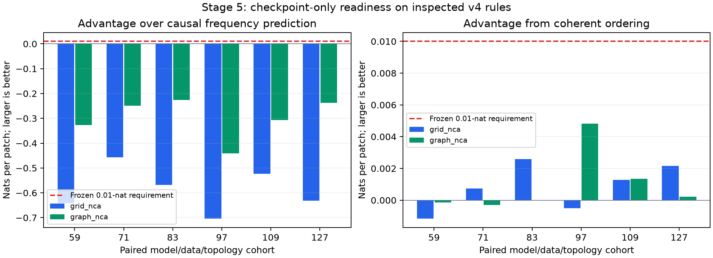

# Stage 5: existing-checkpoint readiness diagnostic

Completed 19 October 2026. **Readiness fails for every grid and graph cohort.**
All 48 planned CPU cross-evaluation cells completed using 24 existing selected
v4 PPT checkpoints. No neural training, language evaluation, GPU job or paid
run was performed. This stage implements the checkpoint-first recommendations
from the [v4 review](../transfer_v4_run1/REVIEW.md); v4's GPU outcomes remain
unchanged. The research objective remains acceleration of learning through
pre-pre-training into an identical language stage.

## Frozen measurement and scope

The [protocol](FROZEN_PROTOCOL.md), [plan](plan.json) and [plan receipt](plan_receipt.json)
were archived before cross-scoring. Plan SHA-256 is
`774e9deefe517adf2b93e7c40c3b1242fa4c97e1942a36e5df9b2db576c678f3`.
The plan binds the diagnostic sources, unchanged v4 sources, reference audit,
config, all consumed cached arrays, selected-checkpoint summaries and weights.
The original ZIP and extracted evidence remain preserved privately. Public
[provenance](PROVENANCE.json) binds seven unchanged copies of the frozen CPU run.

Each of six cohorts (59, 71, 83, 97, 109, 127) contributes grid and graph families.
For each family, both its structured-trained and prefix-shuffle-trained PPT
checkpoints are evaluated on coherent and matched shuffled held-out trajectories.
Each cell scores the same first 32 held-out rules, 936 patch targets per rule
(29,952 targets), using the complete trained context and original patch mask.
Initial conditioning frames, marker positions and supervised target histograms
are matched. No future suffix enters the calculation. Per-rule losses and
accuracies are retained in [results](results.json), alongside all 48 cells.

For each of the 12 structured cohort decisions, BOTH requirements are fixed:

1. Frequency advantage: causal frequency NLL minus structured/coherent NLL
   must be at least **0.01 nats per patch**.
2. Ordering advantage: the same structured checkpoint's shuffled NLL minus
   coherent NLL must be at least **0.01 nats per patch**.

Every cohort and the measurement control must pass before a future language
runner can obtain approved structured checkpoint identities. The new package
has no training command. Its actual `require_readiness` guard was invoked on
this result and rejected it: all 12 structured decisions fail. Historical v4
code retains its original gate; this diagnostic does not retrofit that protocol.

Frequency failures were already inspected during the v4 audit. New order
cross-scores were frozen before inspection, but these are still development
measurements on inspected rules. This is neither untouched confirmation nor
new downstream transfer evidence. The official language test remains unread.

## Measurement controls

Before main scoring, a simple binary cellular rule increments each cell modulo
two. Its 2x2 patch token maps deterministically to its bitwise complement. A
smoothed transition table is fitted only on 256 training initial conditions;
32 held-out initial conditions belong to disjoint complement/phase classes.
The learned table recovers all 16 complement transitions. It uses previous-frame
patch positions, so coherent ordering provides useful predictive information.

| Predictor | Coherent NLL | Matched shuffled NLL | Frequency advantage | Ordering advantage | Readiness |
| --- | ---: | ---: | ---: | ---: | --- |
| Training-fitted transition table | 0.033056 | 5.095285 | 2.384833 | 5.062229 | Pass |
| Causal frequency predictor | 2.417889 | 2.417889 | 0 | 0 | Fail |

The [control evidence](positive_control.json) validates that these measurements
can detect a known ordering signal and reject a frequency-only predictor. It
does **not** establish that our transformer can learn this toy rule, or that the
random NCA rule family is learnable at the existing scale. The toy rule has no
spatial interaction and is a measurement control, not a substitute GraphNCA task.

The frequency prior is fitted to all training supervised patch tokens, with
concentration selected from the frozen six-value grid using only the first 256
training rules. Held-out targets never enter fitting. Its conditional joint
score exactly represents causal online count prediction and is exchangeable
under this matched shuffle. All 12 new frequency scores reproduce the prior
audited frequency diagnostic to within 1e-10 nats.

## Results

Higher advantages are better; each column must reach +0.01 to pass.

| Cohort | Family | Frequency advantage | Ordering advantage | Both pass |
| --- | --- | ---: | ---: | --- |
| 59 | Grid | -0.641566 | -0.001163 | No |
| 59 | Graph | -0.327506 | -0.000143 | No |
| 71 | Grid | -0.457446 | 0.000740 | No |
| 71 | Graph | -0.249498 | -0.000294 | No |
| 83 | Grid | -0.567359 | 0.002581 | No |
| 83 | Graph | -0.225591 | -0.000010 | No |
| 97 | Grid | -0.704043 | -0.000501 | No |
| 97 | Graph | -0.441183 | 0.004817 | No |
| 109 | Grid | -0.522788 | 0.001276 | No |
| 109 | Graph | -0.306300 | 0.001344 | No |
| 127 | Grid | -0.632071 | 0.002162 | No |
| 127 | Graph | -0.237629 | 0.000210 | No |

No cohort passes either requirement. Maximum observed ordering advantage is
0.004817 nats, below the fixed margin. Both families have mixed ordering signs.
Small positive differences remain measurements; gate failure does not establish
exactly zero order dependence or statistical equivalence.

| Six-cohort mean | Grid | Graph |
| --- | ---: | ---: |
| Frequency advantage | -0.587546 | -0.297951 |
| Structured model ordering advantage | 0.000849 | 0.000987 |
| Prefix-trained model ordering gap | 0.000757 | 0.000885 |
| Difference in ordering gaps | 0.000092 | 0.000102 |

For a prefix-trained model the descriptive gap is its shuffled NLL minus its
coherent NLL. The difference in gaps subtracts that control gap from the
structured model's ordering advantage. Both trained models show similar small
gaps, so the coherent-trained checkpoint has little additional ordering
advantage by this diagnostic. These descriptive comparisons do not identify
what caused language transfer. Rule rows are nested observations, not 384
independent model replicates; no new language-transfer significance test is made.

For example, seed 59 graph gives the complete 2x2 comparison:

| Checkpoint | Coherent graph NLL | Matched shuffled graph NLL |
| --- | ---: | ---: |
| Graph-trained | 8.155936 | 8.155793 |
| Prefix-shuffle-trained | 8.157743 | 8.157439 |

The flat [48-cell table](cross_evaluation_cells.csv) and [summary](summary.json)
retain the remaining cells and aggregate decisions. All 24 native cells
reproduce the saved selected-checkpoint NLL and accuracy within 1e-4; maximum
NLL discrepancy is **1.6155661e-7**. The logged main scoring command took
359.539 seconds on CPU, including integrity checks and the measurement control.
This is diagnostic runtime, not a training speedup or cloud billing estimate.

## Implemented checks and next decision

Eight new regression tests cover requiring both finite advantages, frequency
likelihood equivalence, positive/negative controls, agreement with the unchanged
v4 patch evaluator, future-token exclusion, altered-plan rejection and all-cohort
language blocking/acceptance with bound checkpoint identities. The complete local
software suite passes **86 tests**. The report also calls the real guard on these
retained files. Compact-copy checks verify receipts, per-rule aggregates,
checkpoint IDs, native replay tolerances and prior frequency-score agreement.
Configured CI remains distinct from these completed local CPU checks.

**Stop this configuration before further language training.** Keep all original
results and both matched controls. Do not lower the readiness margin, discard a
cohort, increase seeds on the same negative configuration or reinterpret v4's
primary result. The current evidence does not establish dynamics-specific
competence, graph-specific acceleration or total-cost recovery.

The next development objective is a small **transformer trainability diagnostic**:
train the same backbone and patch-prediction pipeline on a known learnable
transition family, with held-out initial conditions and matched shuffles, and
require both frozen readiness advantages. This complements the table-based
measurement control with an actual model-learning check. Declare its training
budget, data split and decision rule before execution. If it fails, inspect the
prediction pipeline/capacity before changing NCA topology. If it passes, bridge
to interacting categorical rules with one representation or capacity change at
a time. No toy task success alone authorizes a full language suite on the
unchanged random-rule checkpoints.

Any graph-local serializer experiment must separately hold topology, rule
family, controls and language protocol fixed. Shorter PPT budgets are a separate
cost-recovery experiment after synthetic readiness; do not change serializer,
topology and budget together. Once a development choice clears readiness,
freeze a new matched transfer study using fresh paired cohorts, identical full
language stages and untouched confirmation data. No such new training run was
launched during this stage.
