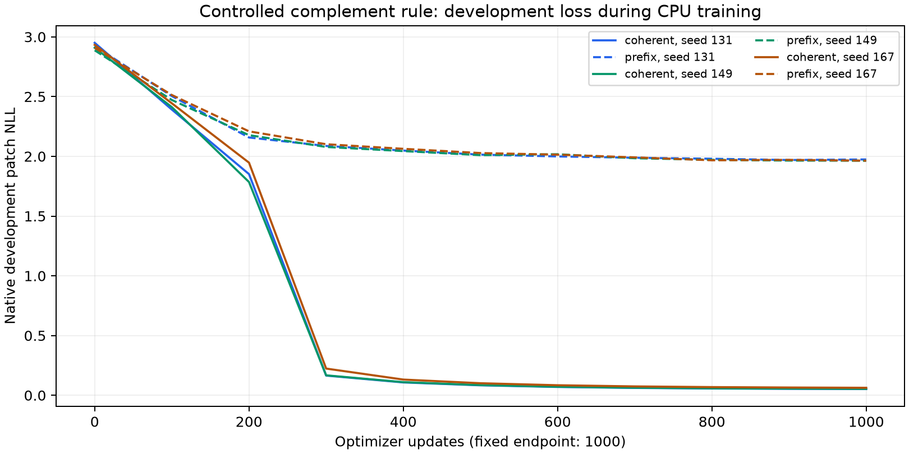

# Stage 6: controlled transformer trainability

Completed 20 October 2026: CPU development diagnostic. **The controlled task passes.**
All 6 models completed their full fixed budgets; every initial/final
assessment cell was replayed from the saved checkpoints. Language training stays
disabled regardless of this outcome. This implements the next objective in the
[stage 5 review](../readiness_v5_run1/REVIEW.md).

## What was held fixed and simplified

The unchanged v4 implementation supplies the full six-layer, width-192,
four-head RoPE/RMSNorm/SwiGLU backbone, tied embeddings, 2x2 patch encoder,
first-frame target mask, marker handling, minibatch/update function, Adam and
1000-update warmup/cosine schedule. The backbone has
2,656,704 parameters; the 18-token model has
2,660,160 parameters. No external pretrained weights are used.

This is the deliberately easier **binary cell-complement rule** on a 4x4 grid
over eight frames: context 47 instead of 1024, vocabulary 18 instead of 10002.
The rule has no spatial interaction or graph topology. Multiple task factors
were simplified for a basic capability check; this does not isolate why v4
random-rule readiness failed. Success can include learning the fixed patch
complement mapping. It does not establish unseen-rule induction, interacting
NCA dynamics, GraphNCA competence, language acceleration or cost recovery.

## Frozen data and endpoint

The [protocol](FROZEN_PROTOCOL.md), [plan](plan.json) and [receipt](plan_receipt.json)
were frozen before training. Plan SHA-256: `3970a3b041e26ddecdd977c22f673b744a5f910643acb809e0d9c63a7b010ed4`.
Sources, all cached arrays and the three actual starting checkpoints are bound
to that plan. The data seed is 20261022, with 512 training, 64 development
and 128 assessment initial conditions. Complement/phase classes are disjoint
across splits. All three model seeds share this one data split; they are model
initialization replicates, not independent data/topology cohorts.

For each seed (131, 149, 167), coherent and prefix-shuffled arms start from the
same full model state and use identical minibatch index order and budgets.
Shuffles preserve the initial frame, markers and supervised target histogram.
The training objective includes subsequent markers; reported readiness uses
patch targets only. Each trajectory contributes 28 scored patches.

Every arm receives exactly 1000 updates / 188,000 input tokens. The endpoint is
the final update, with no checkpoint selection, early stopping or retuning from
development curves. No assessment scores were computed until all six arms
finished. Development curves below are progress diagnostics, not selection data.
The new synthetic assessment is a development capability check; the official
language test and all original v4/v5 evidence remain untouched.

## Final assessment

Both inherited requirements remain **>=0.01 nats per patch**. Higher advantages
are better. All three coherent-trained final models must pass both requirements.
The causal frequency predictor uses training-only prior/concentration fitting.
Its held-out coherent and matched-shuffled joint scores are identical.

| Seed | Coherent NLL | Same checkpoint on shuffled NLL | Frequency advantage | Ordering advantage | Both |
| --- | ---: | ---: | ---: | ---: | --- |
| 131 | 0.052766 | 4.594601 | 2.252567 | 4.541834 | Pass |
| 149 | 0.053680 | 4.590817 | 2.251654 | 4.537137 | Pass |
| 167 | 0.062805 | 4.382613 | 2.242528 | 4.319808 | Pass |

The causal frequency baseline is **2.305334** nats/patch.
Mean coherent-model NLL is **0.056417**; mean patch
accuracy is **100.00%**. Frequency passes:
3/3; ordering passes: 3/3;
joint passes: 3/3. Full-precision per-initial-condition NLL,
accuracy and target counts are preserved in [results](results.json).

A transition table fitted only on this task's training examples recovers all
16 complement mappings. Its assessment NLL is
0.016699 coherent versus
5.576956 shuffled, and its two-part gate
passes.
The frequency-only negative control correctly fails its zero self/ordering
advantages. This table validates the measurement separately from transformer
learning. No language-transfer significance test is inferred from initial-condition
rows or the three shared-data model seeds.

All 18 cells compare each initial, coherent-trained and shuffle-trained checkpoint
on both data versions, with **3584 patch targets per cell**. Read the
[flat assessment table](assessment_cells.csv), [summary](summary.json),
[replay verification](verification.json) and [copy provenance](PROVENANCE.json).
The descriptive shuffle-trained ordering gaps and differences in gaps are retained
for every seed; they are not additional gate criteria or proof of a mechanism.

As a descriptive control check, 3/3 shuffle-trained checkpoints also clear the
absolute readiness margins when rescored on coherent versus shuffled assessment
data. Their much smaller ordering gaps (about 0.06-0.08 nats) and coherent
accuracy (about 27%) differ from the coherent-trained models' 4.32-4.54-nat gaps
and 100% accuracy. This reinforces that the two margins are basic predictive
readiness checks; passing alone does not attribute competence to training on
coherent dynamics. This control inspection does not change the frozen primary
decision or add a post-hoc requirement.

Recorded training stage timers total
**6.966 minutes** across six CPU models,
including development evaluation and checkpoint writing. These are new local CPU
measurements, not GPU speedups or cloud costs. Total updates/input tokens are
6,000/1,128,000. Assessment/export
and verification are outside those per-model timers.

## Integrity and next decision

Eight task-specific regression tests cover split-phase exclusion, exact known
transitions/masks, matched control determinism, frozen configuration restrictions,
plan/array tampering, no assessment before completed training and overwrite refusal.
The complete local software suite passes 94 tests.
A retained tiny two-update CPU fixture checks execution only, separately from
this full-backbone scientific diagnostic. Verification reloads three initial and
six final checkpoints, checks final optimizer update counts, source/input/receipt
identities and reproduces all 18 cells and decisions exactly with the same scorer.
It is a separate replay invocation, not an independently implemented loss function
or a rerun of training from scratch. Private weights, optimizer states and arrays
remain preserved outside the publication.

Declare a bridge to one interacting binary transition rule while keeping the alphabet, grid, context, serializer and training settings fixed. Change the transition rule alone. A later bridge back to the original random-rule task must separately clear readiness.

There is no language-training command in this package. No outcome here changes
the failed readiness of the original random-rule checkpoints. Any future language
suite needs a separately frozen configuration that clears readiness, fresh paired
cohorts and an identical language stage. Graph-local serialization/topology and
shorter-PPT cost-recovery experiments remain separate. No remote training, paid
job or official-language-test evaluation was launched during this stage.
