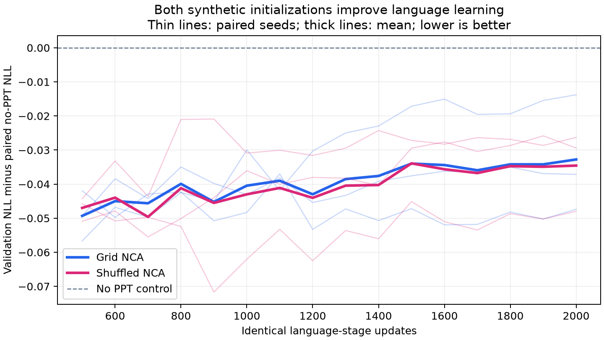

# Transfer v2, returned development run 1

Reviewed 17 October 2026. This is a user-run Kaggle Tesla T4 measurement,
followed by independent local CPU checks. The small execution fixture inside
the archive is excluded from all research results below.

**Finding:** synthetic pre-pre-training improved language-stage learning in
this development experiment. Grid NCA and shuffled NCA performed similarly.
The result does not isolate an advantage from NCA dynamics or establish a graph
benefit. The recorded language savings did not repay the synthetic-stage cost.

## Matched language-stage result

All arms used the same 12,306,048-parameter language architecture, context 1024,
fresh text embeddings/head and optimizer, data order, schedule and 2000 language
updates (8,192,000 input tokens). Grid/shuffled arms first received 1000 PPT
updates (4,096,000 input tokens); the no-PPT arm received no earlier updates.
This fixes the stage-exposure problem in historical pilot 1.

| Initialization | Mean final validation NLL | Language updates to paired no-PPT endpoint (seeds 17 / 29 / 43) | Geometric language-token speedup |
| --- | ---: | --- | ---: |
| No PPT / scratch | 5.266091 | 2000 / 2000 / 2000 | 1.000x |
| Grid-NCA PPT | 5.233321 | 1800 / 1600 / 1700 | 1.178x |
| Shuffled-NCA PPT | 5.231528 | 1700 / 1600 / 1800 | 1.178x |

The reference is each seed's own scratch final validation NLL, according to the
predeclared reporting policy. Evaluation occurs every 100 updates. These are
first recorded crossings, without interpolation or extra training at crossing.
Grid needs 10–20% fewer language updates per seed. Its geometric language-time
speedup is 1.180x, equivalent to about 15.2% less language-stage time. This
measures convergence, not faster transformer updates or a graph-kernel speedup.

At the common final language budget, grid improves NLL by 0.032770 nats/token
on average (about 3.2% lower perplexity). Shuffled improves by 0.034563.
Grid-minus-shuffled final NLL is +0.015606, +0.000604, and -0.010829 across the
three paired seeds; shuffled is slightly better on average by 0.001794 nats.
There is no consistent grid advantage over this control.

The original [full learning curves](gpu/learning_curves.png),
[raw GPU report](gpu/report.json), [recomputed per-seed metrics](metric_audit.json)
and [aggregate values](aggregate.json) are retained alongside this review.

## Synthetic learning and cumulative cost

All three grid seeds passed the declared held-out-rule gate. Patch NLL improved
by 10.24–10.35% from initialization, ending at 8.2866–8.2976 versus the fitted
copy-mixture control's 8.8264. All three shuffled seeds also passed and ended
at 8.2818–8.2873 on their native shuffled validation. The gate establishes
prediction beyond these simple controls; it does not establish that the model
learned local update physics. Native losses use different validation orderings
and should not be read as a direct dynamics comparison.

There are 4096 training and 128 held-out rules; the predeclared evaluator uses
the first 32 held-out rules. Actual rule-weight hashes are disjoint across
splits. Shuffling preserves every full trajectory's token histogram and all
marker positions. It destroys the original patch ordering while retaining
frequency and formatting structure that could itself help initialization.
Which retained property explains transfer is still an open question.

The train screening retained 4096 rules from 8832 candidates; validation retained
128 from 256. Fresh rollout median compression ratios were about 0.5075/0.5080.
Screening uses separate initial conditions, so the screening band is not a
guarantee on fresh trajectories. The final fixed-transition fraction was 0.195%
for train and 0% for validation; this is only a final-transition diagnostic.

Grid's geometric cumulative-time speedup at the paired reference is **0.886x**:
about **12.8% more recorded time**. Cumulative tokens at crossings are
11.4688M / 10.6496M / 11.0592M versus 8.192M for scratch. Thus the primary
language-stage transfer result is positive, and cost recovery at this horizon
is negative. The archive records about 85.9 minutes summed across all measured
PPT/language stages, plus 12.6 seconds of one-time preparation. This is not an
end-to-end notebook runtime.

Cumulative timing includes relevant data preparation, PPT, language setup and
language training/validation. It excludes queueing, package startup, disposable
calibration, and final language checkpoint/verification/plot/archive work.
Timing comes from the returned GPU logs; local CPU replay cannot independently
establish historical wall-clock measurements.

## Verification and provenance

- Original ZIP preserved, separately extracted with path/size checks and CRC
  verification for all 128 members. Returned code was treated as data, never run.
- All ten runner source hashes match trusted canonical code and the recorded
  generation/training identities. Cached corpus/rule/token hashes pass.
- All 15 development checkpoints (six PPT, nine language) reload and reproduce
  validation metrics on CPU within the declared 0.0001 tolerance. Exact maximum
  error: **1.9563e-7**. This is independent of the returned GPU
  verification, which is preserved unchanged.
- Selected PPT checkpoint choice, fitted synthetic controls, gate decisions,
  raw-curve crossing calculations and token accounting were recomputed.
- Actual transferred selected-PPT core hashes and independently reconstructed
  language batch-order hashes match for all nine runs. Recorded initial backbone,
  common head and full schedule hashes match across arms within each seed.
  Logged learning rates also match independent reconstruction numerically.
  Fresh optimizer state and equal budgets are checked in the trusted records.
- The official WikiText test split is absent and all test metrics are null.
  Development validation has now been examined; it is not confirmation data.

An initial attempt to regenerate every initialization/schedule hash failed under
the local Windows/PyTorch 2.14.1 runtime versus Kaggle Linux/PyTorch 2.11.0.
These failures are retained in the check log. The archived step-zero smoke core
differs from local regeneration by at most 7.45e-9; its scientific metrics are
excluded above. Exact initialization/head/schedule bytes are therefore **not
independently reproduced across these runtimes**. This does not affect the
checkpoint loss replay or the matching hashes within the original run.
Platform/version identity is a limit on bitwise seed reproducibility, as
documented by [PyTorch](https://docs.pytorch.org/docs/2.14/notes/randomness.html).
The precise source of each cross-runtime difference has not been isolated.

See [CPU replay](cpu_verification.json), [audit](audit.json),
[stage controls](stage_control_audit.json), and [copy provenance](PROVENANCE.json).
Full datasets and weights remain with the original local evidence and are not
included in the public compact record. The archive SHA-256 is recorded in the
audit and provenance files.

To repeat, run the two helpers through `scripts/run_logged.py`, using the
original ZIP and fresh output directories. The first helper extracts and
re-evaluates; the second reconstructs controls and exports compact evidence.

## What this supports next

The corrected protocol now yields a modest grid-to-language transfer signal.
Three model seeds on one shared synthetic dataset, one small language corpus,
and a 32,768-token validation prefix are exploratory evidence, not a general
speedup claim or a reproduction of the paper's scale.

A graph extension should enter as another PPT initialization before the same
language stage, retaining grid and shuffled controls. It should answer whether
graph data improves on those treatments. Independently seeded synthetic caches,
stronger context-adaptive frequency/format controls, and a frozen confirmation
protocol are needed to separate dynamics from general synthetic-initialization
effects. No new training, retuning, graph implementation or remote launch was
performed during this review. Historical pilot 1 is unchanged.
