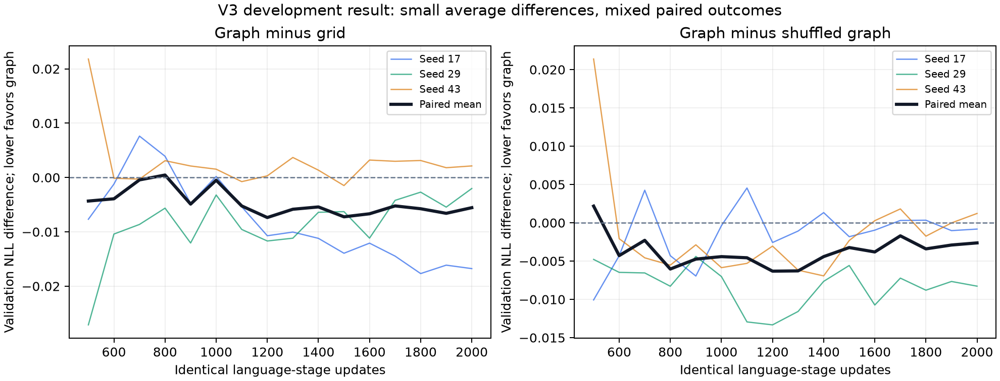

# Transfer v3: first returned graph-versus-grid development run

Reviewed 19 October 2026. The user ran the notebook on a Kaggle Tesla T4 and
supplied `nca_transfer_v3_results_20261018_161811_573163.zip`. This is a different
archive identity from the inaccessible link supplied on 18 October. Preserve
both records rather than silently equating them. The ZIP already resides in
the local `Kaggle Outputs` folder and was preserved unchanged.

**Finding:** graph-NCA pre-pre-training has a small average language-loss
advantage, but the predeclared graph-versus-grid acceleration comparison is
mixed. Graph reaches grid's final loss earlier in one paired replicate, at the
same last update in another, and does not reach it in the third. Its shuffled
control remains close. This does not establish reliable topology-specific or
dynamics-specific acceleration. There is a broader synthetic-initialization
transfer signal relative to no PPT.

## Primary comparison: graph PPT versus grid PPT

Every arm starts at language step zero and receives the same 2000 language
updates, common fresh embedding/head, optimizer setup, schedule, batch/window
order, architecture and validation. Both grid and graph first receive 1000 PPT
updates. These are alternative pre-pre-training initializations, not standalone
substitutes for language training.

The predeclared reference is each paired grid model's endpoint at N=2000:

| Paired replicate | Grid final NLL | Graph final NLL | Graph minus grid | First graph update reaching grid endpoint |
| --- | ---: | ---: | ---: | --- |
| 17 | 5.229810 | 5.213048 | -0.016762 | 1800 |
| 29 | 5.244098 | 5.242078 | -0.002020 | 2000 |
| 43 | 5.239526 | 5.241660 | +0.002134 | Not reached by 2000 |

Lower NLL is better. Evaluations occur every 100 updates, with no interpolation.
Seed 17 gives 1.111x language-token speedup; seed 29 gives 1.000x; seed 43 is
censored. Therefore an all-seed primary speedup is correctly **withheld**, not
computed from the two successful seeds. Mean final graph-minus-grid NLL is
**-0.005550 nats/token**, equivalent to about **0.55% lower perplexity**. The
mean is largely driven by replicate 17; the other two have small opposite signs.

Against shuffled graph, graph's final differences are -0.000824, -0.008274 and
+0.001217 nats. The mean is **-0.002627** (about 0.26% perplexity improvement),
again two favorable endpoints and one unfavorable one. Graph reaches the
shuffled-graph endpoint at 2000 / 1900 / not reached; this aggregate speedup is
also withheld. Grid itself is slightly worse than shuffled grid on mean final
NLL (+0.002922). The structural cause of transfer remains unresolved.

See [recomputed treatment comparisons](treatment_comparisons.csv), the
[raw GPU report](gpu/report.json) and [metric audit](metric_audit.json).

## Additional comparison: common no-PPT reference

| Initialization | Mean final validation NLL | Language updates to paired scratch endpoint, seeds 17 / 29 / 43 | Geometric language-token speedup versus scratch |
| --- | ---: | --- | ---: |
| No PPT / scratch | 5.266091 | 2000 / 2000 / 2000 | 1.000x |
| Grid NCA | 5.237811 | 1900 / 1700 / 1800 | 1.112x |
| Graph NCA | 5.232262 | 1700 / 1600 / 1800 | 1.178x |
| Shuffled grid | 5.234889 | 1800 / 1700 / 1900 | 1.112x |
| Shuffled graph | 5.234889 | 1700 / 1700 / 1900 | 1.134x |

Every synthetic initialization improves the final language endpoint relative
to scratch in every paired replicate. Graph uses 10–20% fewer language updates
than scratch; its geometric language-time speedup is 1.181x, about 15.3% less
language-stage time. This supports synthetic PPT transfer in this small setup.

Using that same scratch target for grid and graph gives a secondary graph-over-
grid token speedup of about 1.059x (about 5.6% fewer language tokens geometrically).
That additional common-target result is useful, but it does not replace the
predeclared, partly censored grid-endpoint comparison above. Its calculation is
retained in [a separate record](secondary_shared_scratch_target.json).
See [aggregate values](aggregate.json) and [original learning curves](gpu/learning_curves.png).

## Synthetic learning, controls and cost

All six structured models (three grid, three graph) passed the declared
held-out-rule learning gate. All six shuffled models passed it too. Every
selected PPT checkpoint was from step 1000, so no untrained or early checkpoint
was selected. The gate tests improvement against global frequency/copy controls;
passing it does not demonstrate learning the local update physics.

Each replicate has 4096 training and 128 held-out rules; model evaluation uses
the fixed first 32 held-out rules. Grid and graph share one frozen rule bank,
with joint complexity eligibility and common rollout random draws. All three
saved graph hashes differ, and exactly 25% of non-self donor entries differ from
the lattice in each replicate. Degree/slot invariants and actual rule-weight
train/validation disjointness pass. Train filtering used 9088 / 9088 / 8896
candidates for 4096 shared retained rules. Fresh rollouts need not stay within
the screening band. [Generator diagnostics](generator_diagnostics.json) retain
that distinction and the measured collapse/complexity summaries.

Shuffled trajectories retain per-trajectory histograms and markers. Their strong
transfer leaves frequency adaptation, formatting and general optimization
conditioning as possible explanations. No specific alternative mechanism has
been identified by this experiment.

At the paired scratch reference, graph's geometric cumulative-time speedup is
**0.871654x**, about **14.7% more recorded cumulative time**. Grid's is 0.838443x.
Thus the language-stage gains do not recover PPT/preparation cost at this
horizon. This secondary cost outcome does not erase the language-transfer gain.
The suite records about 153.15 minutes summed across PPT/language stages and
60.28 seconds of preparation. These are not exact end-to-end cloud billing times.

Timing includes language training/validation, PPT and conservative joint
preparation/setup charges per synthetic arm. It excludes initial snapshot
creation, startup, queueing, disposable calibration and final language checkpoint/
verification/plot/archive work. CPU replay verifies model/data consistency;
it cannot independently recover historical GPU wall-clock measurements.

## Independent verification

- Streamed extraction checked safe paths and CRCs of all 215 members. Returned
  scripts were read as data, never executed. Original archive remains unchanged.
- All 11 runner source hashes, the declared config, generation identity and
  cached data checksums match trusted canonical sources.
- Fitted controls, gate decisions, selected-checkpoint choice, per-seed token
  accounting, raw first crossings and primary censoring were recomputed.
- PPT rule-index order and language window order were independently reconstructed.
  Logged language learning rates match numerically. Full binary schedule hashes
  remain subject to cross-runtime floating-point differences; matching recorded
  hashes within each paired GPU run are checked without claiming byte-identical
  regeneration under a different runtime.
- All **27 selected development checkpoints and three saved initializations**
  pass independent CPU reload checks. Maximum replay discrepancy:
  **1.8552e-7**. The stored initial tensors let us verify shared
  starting weights directly, addressing the v2 initialization-replay limitation.
  Actual selected-PPT-to-language transfer hashes and common head hashes match.
- The original GPU verification remains unchanged; [CPU replay](cpu_verification.json)
  and [audit provenance](audit.json) are separate. No execution-fixture metrics
  enter scientific summaries. Full weights/corpora remain local, outside the
  compact publication record. [Copy provenance](PROVENANCE.json) identifies
  each unchanged imported GPU record.
- Official test data are absent and all final test fields are null. This is
  development validation, now examined, not confirmation data.

The retained archive SHA-256 is
`14d7053a55007d01dd36522bca3885dfcb68894866c30467cf58addc149e2fa5`.
To repeat the audit, run `scripts/audit_transfer_v3_output.py` through
`scripts/run_logged.py`, supplying `--archive` and a fresh `--out` directory.
Then run `scripts/summarize_transfer_v3_audit.py` through the same logger with
`--review` pointing at that audit and a fresh `--out` for compact evidence.
The original ZIP is required and is not part of the source publication.

## Interpretation and next decision

The independent-stage protocol operated as intended. There is no observed
stage-budget, common-head, rule-selection or checkpoint-transfer mismatch to
explain away the small, mixed topology effect. Nor does this run prove that graph
PPT can never help: it tests one rewiring level, one slot-labeled graph family,
one fixed node-label patch serializer, one small corpus/model scale and three
paired model/data/topology replicates. Those three variance sources are not
separately estimated. V3's joint rule filter also changes the grid cohort from
v2, so do not treat grid-v2 versus graph-v3 as a controlled treatment comparison.

The serializer still bundles grid-oriented 2x2 node labels after graph rewiring.
It controls tokenization across arms, but a token's cells need not be neighbors
in the graph. Whether that weakens useful structural transfer is a plausible
design question, not a bug or mechanism demonstrated by these results. Changing
to graph-local serialization would need a separately declared, matched ablation.

For a stronger claim, freeze a target criterion and replicate more independent
paired cohorts; retain both shuffled controls. A stronger causal frequency/
formatting control would help diagnose why shuffled data transfers so well.
Any alternative graph serialization or topology should be a declared new
development ablation, followed by untouched confirmation. Do not relax the gate,
drop replicate 43, or change the primary target after seeing these outcomes.
No new training or benchmark retuning was performed during this review.
